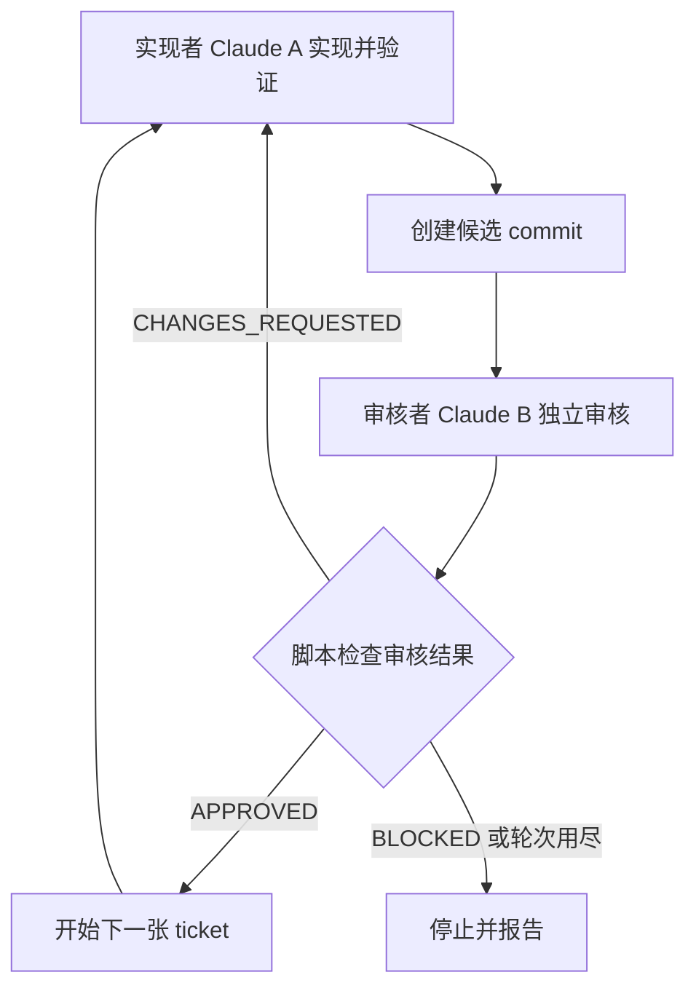

# Claude Code 实现 + Claude Code（第二账号）独立审核

这是可以放进本地项目的轻量协作方案。Claude Code（账号 A）是主执行会话，按照 tickets.md 开发；每轮通过 review.py 启动一个独立的 Claude Code 审核进程（账号 B，独立配置目录、独立额度），读取结构化反馈并修复。通过后继续下一张 ticket。VS Code 用于查看代码、操作终端和检查审核记录。

这不是让两个扩展窗口自动互相发消息：自动交接通过本地进程和文件完成。审核 prompt 每轮重新加载，上轮反馈会作为文件交给新的审核会话。无需另行搭建 MCP 服务。

## 文件

| 文件 | 用途 |
| --- | --- |
| claude-implementer.md | 实现者的完整角色 prompt，包含修复与推进规则 |
| claude-reviewer.md | 审核者的完整 prompt，每轮由脚本传入 |
| review.py | 启动审核、绑定版本、校验结果、记录状态和限制轮次 |
| review.schema.json | 审核结构化输出格式 |
| handoff.example.json | 实现者交接材料格式 |
| runs/ | 自动生成的 ticket 状态、每轮反馈和日志，已被本目录 .gitignore 排除 |

## 1. 安装并登录两个账号（Mac）

需要 Git、Python 3.9+ 和 Claude Code CLI。两个账号共用同一个 `claude` 程序，靠 `CLAUDE_CONFIG_DIR` 区分：

| 角色 | 配置目录 | 登录方式 |
| --- | --- | --- |
| 实现者（账号 A） | `~/.claude`（默认） | 直接运行 `claude` |
| 审核者（账号 B） | `~/.claude-reviewer` | `CLAUDE_CONFIG_DIR=~/.claude-reviewer claude …` |

缺少 CLI 时安装（已安装则跳过）：

```bash
curl -fsSL https://claude.ai/install.sh | bash
claude --version
```

账号 A 已登录则跳过。给审核者登录账号 B：

```bash
CLAUDE_CONFIG_DIR=~/.claude-reviewer claude auth login
```

浏览器打开后，**确认登录的是第二个账号**（必要时先在浏览器里切换 claude.ai 账号）。然后验证：

```bash
python3 agent-workflow/review.py check-reviewer
```

输出中 `reviewer_email` 应为账号 B，`implementer_email` 为账号 A。若两者相同，脚本拒绝审核。若需要换目录，设置环境变量 `REVIEWER_CLAUDE_CONFIG_DIR`，并在启动实现者前 export 它。凭据只保存在各自配置目录或 macOS 钥匙串中，不会写进项目。

## 2. 放进你的项目

用 VS Code 打开包含 tickets.md 的 Git 仓库根目录。将整个 agent-workflow 文件夹放在该根目录，使 `tickets.md` 和 `agent-workflow` 同级。不要覆盖已有 CLAUDE.md、AGENTS.md 或 .claude 配置。

要求已有至少一个 Git commit，且 tickets.md 已被 Git 跟踪。然后新建工作分支并提交协作文件：

```bash
git switch -c ai/ticket-loop
git add agent-workflow/
git commit -m "Add Claude implementation and review workflow"
git status --short
```

最后一条命令应无输出。不要把 `.env`、密钥或运行生成物提交到 Git。runs 目录只用于本地交接，脚本会拒绝已被 Git 跟踪的 runs 文件。

### ticket 进行中修改协作配置

ticket 进行期间，脚本默认拒绝任何改动 agent-workflow/ 的 commit，以防实现者修改门禁。用户自己修改配置时（例如切换审核者），把修改单独提交成一个**只含 agent-workflow/ 文件**的 commit，然后登记：

```bash
git add agent-workflow/
git commit -m "Workflow: <说明>"
python3 agent-workflow/review.py adopt-workflow
```

该命令只接受一个只改 agent-workflow/ 的 HEAD commit，并把它记入当前 ticket 的 `workflow_commits`。若当前 ticket 已 APPROVED，批准随之转移到新的 HEAD。此命令仅由用户运行，实现者 prompt 禁止调用。

## 3. 启动实现者

在项目根目录的终端运行（使用账号 A 的默认配置）：

```bash
claude --append-system-prompt-file agent-workflow/claude-implementer.md
```

然后在 Claude 会话中输入下面这段，把 ID 替换为 tickets.md 中真实的 ID：

```text
从 TICKET-001 开始，按 tickets.md 的依赖顺序完成到 TICKET-003。
严格遵守已加载的 implementer prompt。你可以为每轮候选及修复创建本地 Git commits。
每个 ticket 开始前调用 review.py begin；完成后调用 review.py review，等待审核并按反馈修复。
只有 gate 为 APPROVED 才能开始下一张 ticket。不要 push、部署或修改审核机制。
每张 ticket 最多审核 5 轮；必要验证受阻、需求有实质歧义或轮次用尽时报告并停止。
```

首次请求文件修改、Git commit、测试命令和 review.py 时，按 Claude 的权限提示授权所需操作。不要使用 bypass permissions 来实现自动化。

如果你更喜欢 Claude 的 VS Code 图形面板，打开项目后给它这段启动指令即可：

```text
先完整读取 agent-workflow/claude-implementer.md 和 agent-workflow/README.md，并按这些协作规则执行。
从 tickets.md 中的 TICKET-001 开始，只完成这一张 ticket。
授权为候选和修复创建本地 commits，并通过 review.py 调用独立审核，直至通过或 BLOCKED；不要 push 或部署。
```

## 4. 自动交接的实际过程



实现者会自行执行：

```bash
python3 agent-workflow/review.py begin TICKET-001
# 实现、测试、本地 commit、写 handoff.json 之后：
python3 agent-workflow/review.py review --handoff agent-workflow/runs/TICKET-001/handoff.json
```

review 先检查账号 B 的登录（失败时直接 BLOCKED，不消耗轮次），再启动审核进程。脚本内部调用相当于：

```bash
CLAUDE_CONFIG_DIR=~/.claude-reviewer claude -p --output-format stream-json --verbose \
  --json-schema "$(cat agent-workflow/review.schema.json)" \
  --tools Read,Grep,Glob,Bash --permission-mode dontAsk \
  --setting-sources user --settings '<sandbox 配置>' \
  --strict-mcp-config --disable-slash-commands --no-session-persistence
```

stdin 为完整 reviewer prompt 与本轮请求。启动前脚本移除继承自实现者会话的 `CLAUDE*`/`ANTHROPIC*` 环境变量，审核者只能使用账号 B 的登录。这是解释用的示意命令；日常直接运行 review.py。

审核者的隔离方式对应原 Codex 的 read-only 沙箱：

- 没有 Edit/Write 工具，只有 Read、Grep、Glob、Bash。
- Bash 在 Claude Code 的操作系统沙箱（macOS Seatbelt）中运行，整个仓库禁止写入，网络关闭，可写位置只有 `$TMPDIR`。`allowUnsandboxedCommands: false` 禁止退回非沙箱执行，`failIfUnavailable: true` 让沙箱不可用时直接失败。
- `dontAsk` 模式拒绝一切需要审批的操作；`--setting-sources user` 忽略仓库 .claude 配置，`--strict-mcp-config` 不加载 MCP。

## 5. 看结果和恢复

- `agent-workflow/runs/state.json`：当前 ticket 和状态。
- `agent-workflow/runs/TICKET-001/round-1/review.json`：审核者的逐条验收及反馈。
- 同目录的 `gate.json`：脚本检查后的最终状态。
- 同目录的 `stdout.log`：审核者完整的 stream-json 过程（执行过的命令和结果）；`stderr.log`：CLI 错误输出。

也可以在另一个终端运行 `python3 agent-workflow/review.py status`。审核进行中，脚本使用锁拒绝其他工作流命令；这时直接在编辑器读取 state.json 和日志即可。

若实现者会话中断，在项目根目录用 `claude -c` 恢复，然后要求它先读取状态再继续。不要删除状态来重新计算轮次。

## 6. 参数与边界

- 默认每张 ticket 最多 5 轮，首次 begin 时可设置 `--max-rounds 8`。已开始的 ticket 不会因再次 begin 而重置轮次。
- 单轮默认超时 1800 秒，review 可指定 `--timeout 2400`。超时、异常退出、额度用尽和缺少结构化输出均不能批准。
- 可在 review 命令追加 `--model opus` 等账号 B 可用的模型别名或 ID；默认使用账号 B 的默认模型。
- tickets 文件不在根目录时，首次 begin 使用 `--tickets docs/tickets.md`。
- 若测试必须写入项目、访问网络或读取缺少的凭据，关键 AC 会标记未验证并 BLOCKED。先解决明确的环境缺口；不要把“没运行”当作“通过”。
- 所有候选代码必须已提交，审核时工作区保持干净。发现 Git 版本变化、工作区变脏、AC 缺项、批准中仍有阻断项时，脚本拒绝推进。
- 脚本检查结构化证据是否存在，不能证明证据本身正确。AC 是否完整、代码是否满足要求，仍由独立 reviewer 判断。
- 两个角色是同一模型家族的不同会话，独立性来自独立进程、独立上下文和只读权限，而不是不同厂商的模型。
- 这是本地协作防误操作机制，不是防篡改的强制安全边界。实现者与用户拥有同一工作区的权限。若需要不可绕过的合并门，应在受保护分支/CI 中独立运行审核。
- 运行记录保存在本地忽略目录；不要把凭据或敏感运行数据写入日志。

## 文档依据

2026-10-21 按 Claude Code 2.1.307 及官方文档核对：

- CLI 参数：https://code.claude.com/docs/en/cli-reference
- 非交互模式与结构化输出：https://code.claude.com/docs/en/headless
- Bash 沙箱：https://code.claude.com/docs/en/sandboxing
