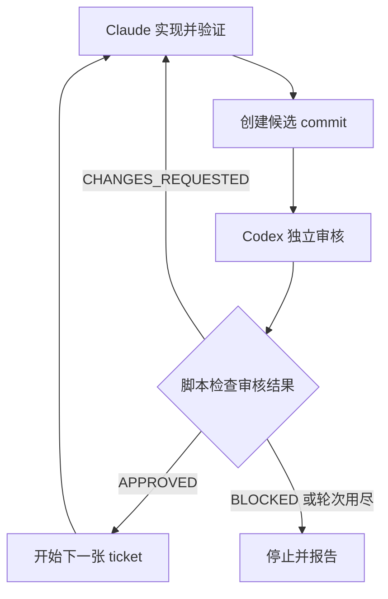

# Claude Code 实现 + Codex 独立审核

这是可以放进本地项目的轻量协作方案。Claude Code 是主执行会话，按照 tickets.md 开发；每轮通过 review.py 启动一个独立的 Codex CLI 审核会话，读取结构化反馈并修复。通过后继续下一张 ticket。VS Code 用于查看代码、操作终端和检查审核记录。

这不是让两个扩展窗口自动互相发消息：自动交接通过本地进程和文件完成。审核 prompt 每轮重新加载，上轮反馈会作为文件交给新的 Codex 会话。无需另行搭建 MCP 服务。

## 文件

| 文件 | 用途 |
| --- | --- |
| claude-implementer.md | Claude Code 的完整角色 prompt，包含修复与推进规则 |
| codex-reviewer.md | Codex 的完整审核 prompt，每轮由脚本传入 |
| review.py | 启动审核、绑定版本、校验结果、记录状态和限制轮次 |
| review.schema.json | Codex 结构化输出格式 |
| handoff.example.json | 实现者交接材料格式 |
| runs/ | 自动生成的 ticket 状态、每轮反馈和日志，已被本目录 .gitignore 排除 |

## 1. 安装并登录（Mac）

需要 Git、Python 3.9+、Claude Code CLI 和 Codex CLI。使用你现有的已授权账户，两个服务分别登录。不会把账户凭据写进项目。

在 VS Code 菜单 Terminal → New Terminal 中，按需安装缺少的 CLI。以下为官方安装命令；已安装则跳过：

```bash
curl -fsSL https://claude.ai/install.sh | bash
curl -fsSL https://chatgpt.com/codex/install.sh | sh
```

重新打开 VS Code 终端后检查：

```bash
claude --version
codex --version
python3 --version
git --version
```

然后先运行 `claude` 完成 Claude 登录，再退出；运行 `codex` 完成 Codex 登录，再退出。不要把 CLI 启动命令输入到另一个 CLI 的聊天输入框。Codex exec 会复用已保存的 CLI 登录。模型沿用各自账户的默认配置；若需固定模型，使用账户实际支持的模型 ID，不要照搬不存在或不可用的名称。

可选：在 VS Code 扩展页安装 Anthropic 发布的 Claude Code，以获得图形界面和 diff 集成。此方案使用终端中的 CLI；只安装扩展并不一定让终端获得 `claude` 命令。Codex VS Code 扩展不是这套自动交接的依赖。

## 2. 放进你的项目

用 VS Code 打开包含 tickets.md 的 Git 仓库根目录。将整个 agent-workflow 文件夹放在该根目录，使 `tickets.md` 和 `agent-workflow` 同级。不要覆盖已有 CLAUDE.md、AGENTS.md 或 .claude 配置。

先用 Source Control 查看并保存你已有的工作，避免把无关文件或凭据放进提交。要求已有至少一个 Git commit，且 tickets.md 已被 Git 跟踪。然后新建工作分支并提交协作文件：

```bash
git switch -c ai/ticket-loop
git add agent-workflow/
git commit -m "Add Claude implementation and Codex review workflow"
git status --short
```

最后一条命令应无输出。若已有同名分支，使用另一个新名称或明确切换到已有工作分支。若项目还不是 Git 仓库，先通过 VS Code Source Control 初始化、检查并选择项目文件完成首个提交，再执行上述步骤。

不要把 `.env`、密钥或运行生成物提交到 Git。runs 目录只用于本地交接，脚本会拒绝已被 Git 跟踪的 runs 文件。

## 3. 启动 Claude Code

在项目根目录的 VS Code 终端运行：

```bash
claude --append-system-prompt-file agent-workflow/claude-implementer.md
```

然后在 Claude 会话中输入下面这段，把 ID 替换为 tickets.md 中真实的 ID：

```text
从 TICKET-001 开始，按 tickets.md 的依赖顺序完成到 TICKET-003。
严格遵守已加载的 implementer prompt。你可以为每轮候选及修复创建本地 Git commits。
每个 ticket 开始前调用 review.py begin；完成后调用 review.py review，等待 Codex 审核并按反馈修复。
只有 gate 为 APPROVED 才能开始下一张 ticket。不要 push、部署或修改审核机制。
每张 ticket 最多审核 5 轮；必要验证受阻、需求有实质歧义或轮次用尽时报告并停止。
```

首次运行建议只授权一张 ticket。确认运行方式与测试环境符合预期后，再给一个范围。

首次请求文件修改、Git commit、测试命令和 review.py 时，按 Claude 的权限提示授权所需操作；权限允许后，它可以自行交接和修复。不要使用 bypass permissions 来实现自动化。如果 Codex 子进程被 Claude 的外层沙箱拦住，按实际提示配置这一条命令的授权，不能靠 prompt 绕过。

如果你更喜欢 Claude 的 VS Code 图形面板，打开项目后给它这段启动指令即可；此时 role prompt 是明确读取的任务指令，而不是 CLI 的 system-prompt 追加项：

```text
先完整读取 agent-workflow/claude-implementer.md 和 agent-workflow/README.md，并按这些协作规则执行。
从 tickets.md 中的 TICKET-001 开始，只完成这一张 ticket。
授权为候选和修复创建本地 commits，并通过 review.py 调用 Codex 独立审核，直至通过或 BLOCKED；不要 push 或部署。
```

## 4. 自动交接的实际过程



Claude 会自行执行以下步骤，不需要你逐轮复制反馈：

```bash
python3 agent-workflow/review.py begin TICKET-001
```

它完成代码、测试及本地候选 commit 后，填写 `agent-workflow/runs/TICKET-001/handoff.json`，再执行：

```bash
python3 agent-workflow/review.py review --handoff agent-workflow/runs/TICKET-001/handoff.json
```

脚本内部调用相当于以下命令的 Codex 会话，stdin 包含完整 reviewer prompt 与本轮请求：

```bash
codex exec --sandbox read-only --output-schema agent-workflow/review.schema.json --output-last-message REVIEW_OUTPUT_PATH -
```

这是解释内部调用的示意命令；日常直接运行 review.py，不要照着占位路径手动执行。Codex 的推理和检查发生在独立 CLI 会话中，Claude 不生成它的 verdict。

## 5. 看结果和恢复

在 VS Code 的文件侧栏查看：

- `agent-workflow/runs/state.json`：当前 ticket 和状态。
- `agent-workflow/runs/TICKET-001/round-1/review.json`：Codex 的逐条验收及反馈。
- 同目录的 `gate.json`：脚本检查后的最终状态。
- 同目录的 `stderr.log`：Codex 运行日志。

也可以在另一个终端运行：

```bash
python3 agent-workflow/review.py status
```

审核进行中，脚本使用锁拒绝其他工作流命令；这时直接在编辑器读取 state.json 和日志即可。

若 Claude 会话中断，在项目根目录用 `claude -c` 恢复最近会话，然后要求它先读取状态再继续。若最近会话不是本工作流，重新用带 `--append-system-prompt-file` 的命令启动，并要求从 runs/state.json 恢复。不要删除状态来重新计算轮次。

## 6. 参数与边界

- 默认每张 ticket 最多 5 轮，首次 begin 时可设置 `--max-rounds 8`。已开始的 ticket 不会因再次 begin 而重置轮次。
- 单轮默认超时 1800 秒，review 可指定 `--timeout 2400`。超时、异常退出和无效 JSON 均不能批准。
- 可在 review 命令追加 `--model ACTUAL_MODEL_ID` 指定审核模型；默认使用 Codex 现有配置。
- tickets 文件不在根目录时，首次 begin 使用 `--tickets docs/tickets.md`，并在给 Claude 的启动指令里说明实际路径。
- Codex 使用 read-only 沙箱。若测试必须写入项目、访问网络或读取缺少的凭据，关键 AC 会标记未验证并 BLOCKED。此时先解决明确的环境缺口，或将审核迁移到可运行测试的隔离副本；不要把“没运行”当作“通过”。
- 所有候选代码必须已提交，审核时工作区保持干净；新文件不能留在未跟踪状态。发现 Git 版本变化、工作区变脏、AC 缺项、批准中仍有阻断项时，脚本拒绝推进。
- 脚本检查结构化证据是否存在，不能证明证据本身正确。AC 是否完整、代码是否满足要求，仍由独立 reviewer 判断。
- 这是本地协作防误操作机制，不是防篡改的强制安全边界。Claude 与用户拥有同一工作区的权限。若需要不可绕过的合并门，应在受保护分支/CI 中独立运行审核，并限制实现者修改门禁。
- ticket 顺序和依赖由 Claude 按 tickets.md 解释，脚本只保证当前 ticket 未批准时不能 begin 另一个。若需要严格的全局调度，应再配置明确的 ticket 清单和依赖图。
- 运行记录保存在本地忽略目录；需要长期审计时按项目要求备份，不要把凭据或敏感运行数据写入日志。

## 文档依据与验证范围

部署命令于 2026-10-21 按官方文档核对：

- Claude Code 安装：https://code.claude.com/docs/en/setup
- Claude Code CLI 与 prompt 参数：https://code.claude.com/docs/en/cli-reference
- Claude Code VS Code 使用：https://code.claude.com/docs/en/vs-code
- Codex CLI 安装与登录：https://developers.openai.com/codex/cli
- Codex 非交互模式、只读沙箱及 JSON schema：https://developers.openai.com/codex/non-interactive-mode

交付前使用临时 Git 仓库与模拟 Codex 进程验证状态门、修复循环、版本检查和失败处理；未访问你的本地 Mac、真实代码仓库或账户，也未执行真实模型调用。因此首次运行仍需验证本地登录、权限、CLI 版本和项目测试环境。
