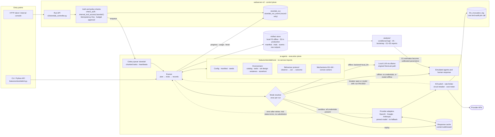
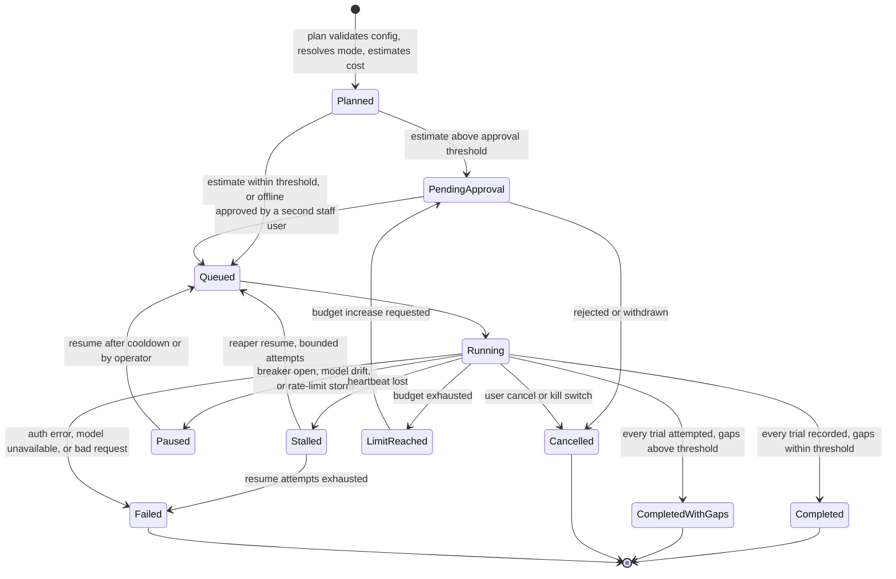
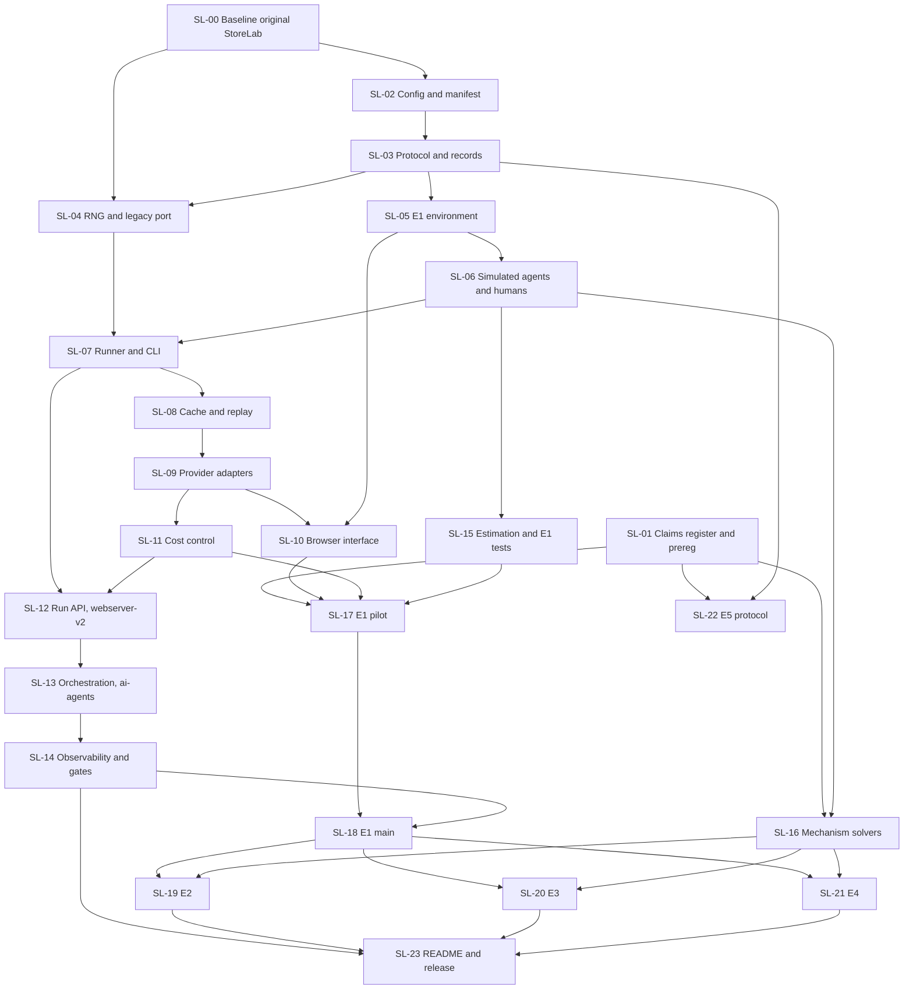

# StoreLab v2: a dual-mode experiment system for agent-mediated shopping

Tickets, architecture and dependencies · draft of 2026-10-21 · no business code changed in this round.

Ticket prefix `SL-`. Sizes: **S** (one PR of 400 added lines or fewer), **M** (2–3 PRs), **L** (4 or more PRs, or a long-running experiment).

---

## 0. Sources and how to read this document

| Source | Location | Used for |
|---|---|---|
| Experimental design (E1–E5, H1a–H5b) | "Experimental Design" section supplied with this request | hypotheses, factors, analyses |
| Model: buyers, effective choice, M1–M4, allocation and payment | `~/Desktop/v1.tex` lines 173–515 | mechanism definitions (`eq:alloc` l.430, `eq:payment` l.435, `prop:ic` l.440, `prop:profit` l.468, `tab:model-benchmarks` l.486) |
| Original experiment ("StoreLab") | `~/Desktop/agentic_amazon/5_storelab/` (not under version control) | original experiment logic, offline mode |
| Original run record | `5_storelab/results/run_meta.json`, `results/findings.md`, `~/Desktop/agentic_amazon/PROGRESS.md` §1.6–3.2 | baseline and known limitations |
| AI-Infra design (AI-INFRA-000…024 control plane) | `webserver-v2/services/control_plane.py`, `webserver-v2/contracts/agentic/`, `services/experiments.py`, `services/offline_evaluation_runner.py`, `services/engine_version.py`, `dao/agent_action_ledger_dao.py` | governance patterns, deciding what to reuse and what not to |
| Job-with-sandbox pattern | `webserver-v2/services/analysis/{jobs,sandbox,replay}.py`, `contracts/analysis/sandbox_container.md`, `v3/analysis_controller.py` | run lifecycle, per-job limits, recorded-run engine |
| LLM plumbing | `ai-agents/features/adgraph/utils/{model_gateway,llm_guard,rate_limiter}.py`, `ai-agents/utils/{llm_circuit_breaker,llm_invocation_log_client,llm_retry}.py`, `ai-agents/evals/pricing.py` | provider calls, guardrails, cost |

§1 states the problem and the hypotheses. §2 defines what each run mode can and cannot show. §3 gives the architecture, §4 the dependency plan, and §5 the assumptions and open items. §6 holds the tickets in dependency order, and §7 lists deferred work.

---

## 1. Experimental problem and hypotheses

The paper makes three kinds of claim:
1. **Behavioural premises** about LLM shopping agents: near-deterministic choice, set dependence, label penalties, and states shared across agents built on the same model.
2. **Mechanism predictions** about click auctions (M1, M2) versus effective-choice mechanisms (M3, M4).
3. **Operational and learning predictions**: set design under shared states, and exploration.

The system therefore has to:
- measure real agents' choices on controlled candidate sets (E1);
- run calibrated market simulations that use the E1 estimates (E2–E4);
- specify and analyse a field experiment that the sandbox cannot replace (E5).

### 1.1 Research hypotheses (claims register summary; SL-01 makes each one testable)

Kind: **P** = premise about real agents, **Pr** = prediction tested under finite noise or heterogeneity, **I** = exact consequence of the model, where simulation only checks the implementation.

| ID | Claim | Source | Kind | Exp. | Run mode | Primary analysis |
|---|---|---|---|---|---|---|
| H1a | The odds of choosing *i* over *j* change when a product preferred to both is added or removed (an IIA violation) | premise | P | E1 | sandbox | Hausman–McFadden test; triple odds test |
| H1b | Repeated identical presentations give the same choice in most trials, and score gaps are large relative to σ | Lemma small-noise, Ass. deterministic | P | E1 | sandbox | modal-choice share; v/σ gaps; separation diagnostics |
| H1c | δ_m/σ_m < 0, and it differs across models | premise | P | E1 | sandbox | conditional-logit Wald test (one-sided); equality test across models |
| H1d | Version changes reorder favourites for a non-negligible share of tasks; alignment with *u* is tested | premise | P | E1 | sandbox | Spearman ρ; favourite-change share; binomial test on alignment |
| H1e | Browser-based agents request pages of products they do not choose | Ass. retrieval | P | E1 | sandbox (`browser_tool`) | rate with Wilson CI |
| H2a | Under agent-aware organic policies, agent-traffic payments under M3 are 0 and total payments go to 0 as α→1; under human-optimised organic policies they rise with \|F(x)\|−(K−K^s) | Prop rents | Pr | E2 | offline, calibrated on E1 | TOST equivalence; trend test |
| H2b | Gating raises profit by nξE[min{θ_f,θ_r}] and lowers match quality; with human traffic, the gain is non-decreasing in α | Prop gating, Conj gating | I / Pr | E2 | offline | relative error against the formula; trend test |
| H2c | M2 revenue ∝ E_μ[1−α(x)]; M1 payment per effective choice rises with αχ̄; the set-blind gap is 0 with fixed organic lists and grows with organic variation | Lemma click, Prop setblind | Pr | E2 | offline | regression slopes; gap CIs |
| H3a | The separated policy matches expected loads, contributions and match quality with no across-state variation; composition-blind randomisation keeps exposure near the Lemma contested bound | Lemma contested, Prop separation | I / Pr | E3 | offline | exact comparison; variance decomposition |
| H3b | When states carry quality information, the optimal head-to-head share follows the closed forms | Prop threshold | I | E3-A | offline | numeric optimum vs closed form |
| H3c | With sponsorship, leaders buy back sponsored inclusion under M3, and under M4 only when bids exceed the congestion term | Cor congestion | Pr | E3-B | offline | allocation comparison |
| H4a | The identified share is determined by reachability in 𝒢_𝒜, not by inclusion frequency | Prop identify | Pr | E4 | offline | identification rate by design |
| H4b | Error ∝ h^(−1/2); flat in n₀ when Var_Λ(q)>0, falling in n₀ when it is 0 | Prop learning(a) | I | E4 | offline | log-log slopes with CIs |
| H4c | The maximum misreport gain is below 2θ_j n ε₁ and declines with h | Prop learning(d) | Pr | E4 | offline | grid search vs bound |
| H4d | Cumulative loss ∝ √h | Cor cumulative | Pr | E4 | offline | log-log slope |
| H5a | Purchases net of returns per effective choice are equal between the strong-competitor and weak-competitor arms | Ass. value | P | E5 | field | randomisation inference |
| H5b | The qualifying event predicts purchases better than clicks, across arms and traffic types | Ass. value | P | E5 | field | out-of-sample log-loss / AUC |

### 1.2 System hypotheses (engineering claims, verified by acceptance tests)

| ID | Claim | Verified in |
|---|---|---|
| S1 | Offline runs are bit-reproducible: same config, seed and code give identical trial records, in any execution order and across resumes | SL-04, SL-07, SL-14 |
| S2 | Mode parity: one design yields identical candidate sets, positions, labels and rendered prompts in every mode; only the choice source differs | SL-03, SL-05, SL-10 |
| S3 | No silent substitution: every outcome is attributable to one backend and one model id; every non-choice is labelled `invalid`, `refusal`, `error` or `not_run` | SL-03, SL-07, SL-09 |
| S4 | Replay fidelity: replaying a sandbox run makes zero provider calls and reproduces its records | SL-08 |
| S5 | Budget safety: spend ≤ `max_usd` + concurrency × max per-call cost | SL-11 |

Engineering acceptance never depends on the direction of a research result. A hypothesis is labelled *supported*, *not supported* or *inconclusive* by the decision rule registered in SL-01.

---

## 2. What each mode can and cannot show

| | Offline · simulated | Offline · local LLM (original StoreLab path) | Sandbox · provider API | Replay |
|---|---|---|---|---|
| Choice source | parametric agent and human models (stipulated or E1-estimated) | local model via ollama (original: `qwen2:7b`) | live provider model, pinned snapshot | recorded outputs of an earlier run |
| Network | none | localhost only | provider hosts only | none |
| Reproducibility | bit-exact from seed | best effort (seed, model digest recorded); exact through replay | generation is not reproducible; exact through replay | bit-exact |
| Can test premises (E1)? | No: it assumes them | Only for that local model; does not count toward "≥3 providers" unless registered | Yes | Re-analysis only |
| Main use | E2–E4, dry runs, parameter recovery, CI | reproducing the August run, smoke tests | E1 | audits, re-analysis, resume |

**Valid comparisons across modes.** Because observations are identical by construction (S2), trial-paired comparisons are valid. The main one is predictive fit: log-loss and calibration of E1-calibrated simulated agents on held-out API choices. This measures how well the offline mode stands in for real agents. E2–E4 results are statements about "agents that behave like the estimated model", not about observed agents.

**Not comparable, or limited:**
- The August 2026 StoreLab results (interface regimes, GSP and invalid-traffic filtering, `qwen2:7b`, synthetic catalog, prompt-induced extras; `PROGRESS.md` §3.2(c)) answer a different question with different metrics. Cite them separately and do not pool them with E1–E4.
- The human arms (`HumanSim` cascade; separable human response, Ass. human, `v1.tex` l.236) are stipulated or calibrated to published position effects. They are not human evidence.
- Sandbox purchases are not real, so the sandbox cannot speak to advertiser value. That is E5's job.
- API results are tied to a model snapshot and access date. Aliases move, temperature semantics differ across providers and reasoning models, and temperature 0 does not mean deterministic.
- `browser_tool` is a tool-driven browser, not a GUI agent such as Comet or computer-use. H1e conclusions are limited to it unless SL-10b runs (§7).
- Within a state, the simulated logit satisfies IIA, and IIA violations appear only through mixtures over Λ and models. If H1a rejects IIA within a model, E2–E4 sets that E1 did not observe rely on a misspecified extrapolation. E2 then reports by interface and flags this.
- All results depend on the registered prompt templates. A prompt-variant robustness arm is optional (SL-17).

---

## 3. Architecture

### 3.1 Principles
1. **One core, several choice sources.** Environment, protocol, records and mechanisms live in `ai-agents/features/storelab/core/`, which imports nothing from the service code. Modes differ only in the backend that turns an observation into an action.
2. **The mode is decided once, at plan time, and written into the manifest.** `auto` resolves to `sandbox` only when every configured provider has credentials, and to `offline` when none does. Partial credentials fail the plan. A run never changes mode afterwards.
3. **Nothing is substituted silently.** A failed or invalid call is recorded as such. It is never replaced by another model, a simulated choice or the first listed item; the last is what the original code does, at `agents.py` l.212–214, 264–266 and 307–309.
4. **Everything is addressed by hash and versioned:** config, design, prompts, environment code, dataset snapshot, model ids and cache entries.
5. **Reuse the AI-Infra platform where it fits, and keep out the parts built for ad-platform mutations.** See the "not reused" rows in §3.2.

### 3.2 Components: reuse, modify, new

| Component | Status | Location | Reference and reason |
|---|---|---|---|
| Original environment (catalog, GSP, page, IVT, `HumanSim`, renderers) | **Port, logic preserved** | `features/storelab/core/legacy_env.py` | `5_storelab/storelab.py`, `agents.py` l.100–168 |
| Local LLM client (ollama) | **Port and fix** error handling | `features/storelab/backends/local_llm.py` | `agents.py` l.41–94 returns `""` after 3 failures |
| Config, manifest, seeds, protocol, records | **New** | `features/storelab/core/` | none |
| Simulated agent and human models | **New** | `features/storelab/backends/simulated.py` | `v1.tex` l.236–309 |
| Runner, CLI, Python API | **New**; generalises the original per-arm checkpoints | `features/storelab/core/runner.py`, `cli.py` | `run_experiment.py` l.127–193 |
| Response cache and replay | **New**; follows the recorded-run idea | `features/storelab/core/cache.py` | `webserver-v2/services/analysis/replay.py` |
| Provider adapters (OpenAI, Google, Anthropic) | **New**; reuse gateway sub-components, not the facade | `features/storelab/backends/` | why the `AdgraphClient` facade is not reused: SL-09 |
| LLM kill switch | **Reuse** | `features/adgraph/utils/llm_guard.py:183` | `enforce_llm_kill_switch` |
| Rate limiting and provider concurrency | **Reuse** | `features/adgraph/utils/rate_limiter.py:597,648,765` | `acquire_provider_slot`, `release_provider_slot`, `acquire_model_capacity` |
| Circuit breaker | **Reuse** (state is per worker) | `utils/llm_circuit_breaker.py:141` | counts 5xx, timeouts and connection errors, not 429 |
| Per-call cost and audit log | **Reuse** | `utils/llm_invocation_log_client.py:553` | durable write; `invocation_kind="storelab"` |
| Price table | **Modify** (add the pinned model ids) | `evals/pricing.py:30` | single source of USD rates |
| Celery, DLQ, Redis lock | **Reuse**, plus a new queue | `workers/celery_app.py`, `workers/dlq_capture.py`, `utils/redis_lock.py` | none |
| Settings | **Modify** | `ai-agents/config/settings.py` (`StorelabSettings`); `webserver-v2/config_info/settings.py` (`STORELAB_*`) | repo configuration conventions |
| Run API and lifecycle | **New**, modelled on analysis jobs | `webserver-v2/services/storelab/`, `v3/storelab_controller.py` | `services/analysis/jobs.py` (`finish` l.400, cost limit l.561); `v3/analysis_controller.py:244` (`engine_route`) |
| Idempotency | **Reuse** | `webserver-v2/services/idempotency/decorator.py` | `Idempotency-Key` header |
| Staff authorisation | **Reuse** | `webserver-v2/services/internal_tool_access.py:24` | tool key `storelab` |
| Run audit trail | **New**, record-only tables in the ledger style | `webserver-v2/db/flyway/vector/sql/` | `dao/agent_action_ledger_dao.py` (record-only tables) |
| Code fingerprint | **Reuse the approach** | `webserver-v2/services/engine_version.py:16` | `source_fingerprint` |
| Mechanism solvers (M1–M4, profit rule) | **New** | `features/storelab/core/mechanisms/` | `v1.tex` l.419–500 |
| Estimation and statistical tests | **New**; bootstrap and permutation helpers ported | `features/storelab/analysis/` | `5_storelab/analyze.py` l.51–80 |
| Isolated container for a rendered-page browser agent | **Deferred** (SL-10b) | ECS on Fargate | `services/analysis/sandbox.py`, `contracts/analysis/sandbox_container.md` |
| *Not reused:* `services/control_plane.py`, `services/kill_switch.py` (`agent_control`), VersionBundle and promotion registry, `services/experiments.py` | — | — | They govern proposals that **mutate ad platforms** and promote production agents. StoreLab runs mutate nothing and are never promoted. Revisit only if a StoreLab-derived policy is proposed for production; it would then enter through `offline_evaluation`. |

### 3.3 System design (draft of the README diagram, finalised in SL-23)



### 3.4 Run lifecycle



**Mode resolution (`mode: auto | offline | sandbox | replay`).**
- `auto`, no provider credentials → `offline` with the agent backend from `agents.offline_backend` (`simulated` or `local_llm`). The reason is recorded, for example "no credentials for openai, google, anthropic".
- `auto`, every configured provider has credentials → `sandbox`.
- `auto`, some providers have credentials → **plan error** that lists the missing providers. The design is not changed to fit.
- `sandbox` without credentials → plan error. It never falls back to `offline`.
- `replay` needs `source_run_id`, and the cache policy is forced to `read_only`.

### 3.5 Runtime error policy (fixed before the run; changing it changes `config_hash`)

| Condition | Trial result | Run effect |
|---|---|---|
| HTTP 429 | retry with exponential backoff, honouring `Retry-After`, up to `max_attempts`; then `error/rate_limited` | if the rate-limited share in a sliding window exceeds the threshold → `PAUSED` |
| 5xx, timeout, connection error | retry; then `error/provider_unavailable` | feeds the circuit breaker; breaker open → `PAUSED`, auto-resume after cooldown at most N times, then `FAILED` |
| 400 bad request (for example an unsupported parameter) | no retry; `error/bad_request` | `FAILED` on first occurrence (a design defect) |
| 401 / 403 | no retry; `error/auth` | `FAILED` |
| 404, model not found or retired | `error/model_unavailable` | `FAILED`, because the design would lose balance |
| Returned model snapshot changes mid-run | outcome kept, both ids recorded | `PAUSED`, flagged `model_drift`; resuming is a human decision |
| Safety refusal | `refusal` (behavioural data, not an error) | rate reported |
| Unparseable output, unknown id, turn limit reached | `invalid` with reason; no re-ask unless `reask_once` is registered | counts toward per-cell missingness |
| Call would exceed the budget | `not_run` | `LIMIT_REACHED`, resumable after approval |
| Kill switch engaged | `not_run` | `CANCELLED` (reason `kill_switch`) |
| Replay cache miss | `error/cache_miss`; no live call | run marked incomplete |

**Never allowed:** switching provider or model; switching to offline or simulated choices; substituting a listed item; dropping a trial without a record; an unregistered re-ask. The SDKs' own retries are disabled (`max_retries=0`) so that the runner's attempt counts are exact.

### 3.6 Identity, seeds and idempotency keys

- `master_seed` (int64) is registered. Random streams are derived by key, never by call order: `stream(seed, "design", task_id, K)`, `("presentation", set_id, rep)`, `("agent", trial_key)`, `("market", config_id, idx)`, `("bootstrap", analysis_id)`. They use `numpy.random.SeedSequence` seeded from sha256 of the keys. This fixes the order dependence in the original code (`storelab.py` l.123, 131, 271, 325, combined with resume at `run_experiment.py` l.165–170).
- `config_hash = sha256(canonical JSON of the trial-affecting config)`; `run_id` is a UUID4.
- `trial_key = sha256(config_hash, task_id, set_id, presentation_id, interface, model_key, temperature, rep)`. Records are deduplicated on it, which makes resume idempotent.
- `call_key = sha256(provider, requested_model, params, tool_schema_version, prompt_template_sha, rendered_messages, rep, sample_namespace)`. It includes `rep`, so intended repetitions are never served from cache as duplicates.
- HTTP creation uses `Idempotency-Key`. Celery chunks are acked late, with a per-run Redis lock.

### 3.7 Artifact layout (local directory offline, S3 prefix in production)

```
runs/<run_id>/manifest.json           resolved config, hashes, versions, mode and reason, status history
runs/<run_id>/plan/trials.parquet     planned trials (trial_key, design coordinates)
runs/<run_id>/records/part-*.jsonl.gz append-only TrialRecord and EventRecord shards
runs/<run_id>/export/*.parquet|csv    analysis-ready tables
runs/<run_id>/reports/quality.json    gaps, balance, invalid and error rates, cost vs estimate
cache/<provider>/<model_id>/<call_key>.json
datasets/<name>/<sha256>/...          dataset snapshots with access date
```

---

## 4. Dependencies and plan



| Phase | Tickets | Can run in parallel with | Exit gate |
|---|---|---|---|
| 0 Foundations | SL-00, SL-01 (draft) | all of Phase 1 | baseline hashes recorded |
| 1 Offline core | SL-02 → SL-03 → {SL-04, SL-05} → SL-06 → SL-07 → SL-08 | SL-15, SL-16 after SL-06 | **G1**: golden offline hash stable; resume test passes |
| 2 Sandbox | SL-09 → {SL-10, SL-11} | Phase 3 | **G2**: live smoke run; no-substitution audit = 0 |
| 3 Control plane | SL-12 → SL-13 → SL-14 | Phase 2 | container-boot checks green; chaos tests pass |
| 4 Analysis code | SL-15, SL-16 | Phases 2–3 | recovery and solver checks pass |
| 5 Experiments | SL-17 → (prereg frozen) → SL-18 → {SL-19, SL-20, SL-21}; SL-22 separately | none | **G3**: pilot estimator error ≤25%, power design chosen; **G4**: prereg timestamp before the first E1 main trial |
| 6 Delivery | SL-23 | none | quickstart reproduces the golden hash in a clean environment |

**External dependencies:** API keys and spend budget (A5, A9); the statements of paper Sections 4–6 (A1); dataset terms (A7); an E5 partner (A10); approval to release code (A8).

---

## 5. Assumptions and items to confirm

| ID | Item | Assumption used in this plan | Blocks |
|---|---|---|---|
| A1 | Formal statements of Props rents, gating, setblind, separation, threshold, identify, learning; Lemmas click and contested; Cors congestion, design, cumulative; Conj gating | **Supplied 2026-10-22** in `requirements/A1_formal_statements.md` from the paper snapshot `requirements/paper.tex`. Its §E (corrections: Cor design(b) bound, H4b and H4d wording, H2a payment attribution and screen) governs where it differs from §1.1 | SL-01, SL-16, SL-19–21 |
| A2 | Symbol definitions: χ_m, F(x), ξ, ε₁, h, n₀, N_x, "agent-aware", "gated", "set-blind M3" | **Fixed 2026-10-22** in `requirements/A1_formal_statements.md` §E7. Corrections: N_x = \|E(x)\| (eligible products in context x, not the number of contexts); n₀ = audit requests per cell per period; χ_m = probability of requesting each displayed product's page, independent of the choice. "Gated" now has an operational definition | SL-06, SL-16, SL-19, SL-21 |
| A3 | "AI-Infra design in memory" | no such memory note exists; taken to be the AI-INFRA-000…024 control plane in `webserver-v2` | §3.2 |
| A4 | "Original experiment logic" | StoreLab at `~/Desktop/agentic_amazon/5_storelab`, run on 2026-08-14 with `qwen2:7b` (520 episodes, 430 calls); not under version control | SL-00, SL-04 |
| A5 | E1 providers and versions | OpenAI, Google, Anthropic, with ≥2 pinned snapshots each. Anthropic needs a new SDK dependency and key; the gateway supports only OpenAI and Google (`config/settings.py:959`) | SL-09, SL-17 |
| A6 | What counts as "browser-based" for H1e | `browser_tool` (§2); a GUI agent requires SL-10b | SL-10, SL-18 |
| A7 | Amazon Reviews 2023 terms (Hou et al. 2024) for research use and for redistributing derived data | research use allowed; redistribution limited to ids and derived fields until confirmed | SL-05, SL-23 |
| A8 | Hosting the research core in `ai-agents` and releasing `core/`, `analysis/` and configs publicly | needs company approval; the import-boundary test keeps the subset separable | SL-02, SL-23 |
| A9 | API and compute budget ("TBD" in the paper) | set after SL-17; pilot cap to be agreed (placeholder $150) | SL-17, SL-18 |
| A10 | E5 partner and sample size | TBD; SL-22 delivers protocol and analysis only | SL-22 |
| A11 | Human position weights | taken from Ursu (2018) where reported, otherwise a grid; the numbers still need extracting | SL-06, SL-19 |
| A12 | Pre-registration venue and thresholds ("most trials" in H1b, "non-negligible" in H1d, the H2a equivalence margin, per-cell missingness tolerance) | **Fixed 2026-10-22** in `requirements/A12_thresholds.md`: OSF Registries; H1b modal share ≥ 0.80 and gap ≥ ln 4; H1d favourite-change share ≥ 0.10; H2a margin 0.01 of mean value per agent request; missingness 10% / 25%; plus the other registered numbers and minimum N | SL-01 |
| A13 | S3 bucket, retention, data classification | dedicated prefix; no customer or PII data is ever in prompts or records | SL-12, SL-13 |
| A14 | PR size convention (≤400 added lines) vs the vendored legacy snapshot (~1,700 lines) | one vendored PR exempted and labelled, or the snapshot archived outside the repo with hashes | SL-00 |
| A15 | Presentation randomisation for H1b | positions and labels drawn once per set and repeated identically r=10 times (`per_set`), so repeats measure pure choice noise; label and position effects are identified across sets | SL-05, SL-01 |
| A16 | Regularity for the profit rule | lognormal values can violate monotone virtual values; use ironing or restrict parameters (registered) | SL-16 |

---

## 6. Tickets

### SL-00 · Baseline the original StoreLab
**Size** S · **Repo** ai-agents · **Depends on** — · **Kind** engineering

**Objective & Validation**
- The original experiment is not version-controlled and was run once. Freeze it as a hash-identified baseline so that "preserve the original logic" can be checked, not just asserted.
- Validates that the original analysis is reproducible from the saved data, which is a precondition for S1.

**Scope**
- In: vendor `storelab.py`, `agents.py`, `run_experiment.py`, `analyze.py` and `make_figures.py` byte-for-byte into `ai-agents/features/storelab/legacy_2026_08/`, excluded from ruff and coverage. Store `results/*.json`, `logs/events.json` (1.5 MB) and `findings.md` in the artifact store with hashes. Write a defect list with file:line references.
- Out: re-running the LLM arms (ollama output is not reproducible); any behaviour change.
- Known defects to record, each mapped to the ticket that fixes it:
  - shared, order-dependent RNGs (`storelab.py` l.123, 131, 271, 325; with resume at `run_experiment.py` l.165–170) → SL-04;
  - silent substitutions (`agents.py` l.61–73 returns `""`; l.212–214, 264–266, 307–309 fall back to `items[0]`) → SL-03, SL-07;
  - no prompt version or model digest in `run_meta` (`run_experiment.py` l.228–236) → SL-02;
  - hard-coded `temperature=0.7, top_p=0.9` (`agents.py` l.44, 56) → SL-02;
  - prompt-induced extras channel (`PROGRESS.md` §3.2(c)) → legacy only.

**Inputs & Dependencies**
- `~/Desktop/agentic_amazon/5_storelab/`; Python 3.11 (ai-agents) and the original 3.9.13 interpreter for a cross-check; numpy, scipy and pandas versions recorded as found. Decision on A14.

**Procedure**
1. Compute sha256 for every source and result file; write `PROVENANCE.md` (path, hash, size, mtime, run date from `run_meta.json`).
2. Copy the code unchanged; upload the data files with hashes.
3. Run `analyze.py` on the saved `episodes.json` and `events.json` under 3.11, then diff against `findings.md`. Its bootstrap and permutation RNGs are fixed-seeded (`analyze.py` l.46), so an exact match is expected.
4. Run `build_catalog()` and compare with `run.log`: 2,004 SKUs, 712 ad-eligible.
5. Write the defect list.

**Deliverables**
- `legacy_2026_08/` (code), `PROVENANCE.md`, `REPRODUCTION.md` (commands, interpreter versions, diff result), defect list (Markdown table).

**Acceptance Criteria**
- [ ] sha256 of every vendored file equals that of its source file.
- [ ] `analyze.py` on the saved data regenerates `findings.md` with zero diff. Any diff blocks closure until it is root-caused and documented.
- [ ] `build_catalog()` yields 2,004 SKUs, 712 of them ad-eligible.
- [ ] Every defect has a file:line reference and a target ticket.

---

### SL-01 · Claims register and pre-registration
**Size** M · **Repo** ai-agents (docs) · **Depends on** A1, A2, A12; finalised after SL-17 · **Kind** research design

**Objective & Validation**
- Make every hypothesis falsifiable before data collection: metric, estimator, test, tolerance and decision rule fixed in advance. This separates engineering acceptance from research conclusions.
- Validates nothing about the results; it fixes how they will be read.

**Scope**
- `features/storelab/docs/claims_register.yaml`, machine-readable and consumed by `analysis/` to label outputs, plus its JSON Schema.
- `preregistration_E1.md` and `preregistration_E5.md`. The paper requires H1–H5 to be registered before E1 and E5 run.
- Per claim: id, source (label), statement, experiment, unit of analysis, metric, estimator, test, α or CI level, multiplicity family, tolerance or equivalence margin, minimum N, decision rule (supported / not supported / inconclusive), the reading of each outcome taken from the paper's "Interpretation" paragraphs, and status.
- Shared definitions:
  - ground-truth utility u(x, j) for E1 tasks;
  - the effective-choice event per interface;
  - treatment of `invalid`, `refusal` and `error`: primary analysis treats them as missing; sensitivity analysis treats them as the outside option;
  - per-cell missingness threshold;
  - thresholds for "most trials" (H1b) and "non-negligible" (H1d); the H2a margin;
  - presentation randomisation (A15); profit-rule regularity (A16).
- Out: running analyses.

**Inputs & Dependencies**
- Paper §3–7; `v1.tex` l.173–515; Sections 4–6 statements (A1); pilot effect sizes from SL-17 for the sample sizes.

**Procedure**
1. Extract each claim and write its formal metric and test.
2. For every exact (I-type) result, write the closed form and the numerical tolerance used in its implementation check (E2 H2b, E3-A, E4 H4b).
3. Specify the required operating characteristics of each test: empirical size in [0.03, 0.07] at α = 0.05 over 1,000 Monte Carlo replications under the null. SL-15 and SL-22 verify them.
4. Register E1 after SL-17, before SL-18; register E5 before any field data exists.

**Deliverables**
- YAML register and schema; two pre-registration documents; registration receipts (OSF links and timestamps).

**Acceptance Criteria**
- [ ] A unit test validates the register against its schema; every claim H1a–H5b has all required fields filled in.
- [ ] `analysis/decide.py` maps a synthetic results file to a decision label for every claim without manual input.
- [ ] No acceptance criterion in this document requires a particular direction of result (reviewer checklist item).
- [ ] The E1 registration timestamp is earlier than the first SL-18 trial timestamp (checked from manifests).

---

### SL-02 · Unified configuration, run manifest and version capture
**Size** M · **Repo** ai-agents · **Depends on** SL-00 · **Kind** engineering

**Objective & Validation**
- One configuration language for every mode, so a run is fully specified by (config, seed, code version) and is traceable: seed, model and prompt versions, mode, cache policy.
- Validates the S2 precondition and the traceability requirement.

**Scope**
- `core/config.py`: pydantic v2 models with `extra="forbid"`. Sections: experiment, mode, seed, environment, design, interfaces, agents (online models + `offline_backend`), humans, mechanism (E2–E4), protocol, repetitions, cache, failure_policy, budget, outputs.
- `core/manifest.py`; `core/versioning.py` (fingerprinting in the style of `webserver-v2/services/engine_version.py:16`).
- Overrides `--set key=value` and the API equivalent. Overrides go into the resolved config and therefore into `config_hash`.
- The manifest records:
  - resolved config, `config_hash`, `run_id`;
  - requested and resolved mode, with the reason;
  - git SHA and dirty flag; Python and package versions (numpy, scipy, cvxpy, provider SDKs);
  - `env_version` (source fingerprint); prompt template ids with sha256; `protocol_version`;
  - dataset snapshot hash;
  - per model: requested id, observed returned ids, first and last access UTC, temperature semantics (`provider_default` or explicit value), `seed_supported`;
  - cache policy and namespace; governance kind (`local` or `platform`); status history.
- Out: storage (SL-07); HTTP (SL-12).

**Inputs & Dependencies**
- SL-00 defect list; the factor lists of E1–E4.

**Procedure**
1. Define the models; canonical JSON (sorted keys, fixed float repr) → `config_hash` over the trial-affecting fields. Explicitly excluded fields: `outputs.*`, `budget.*`, `failure_policy.breaker.*`.
2. Validation rules:
   - `temperature: 0` on a model that does not accept temperature raises a `ValidationError` naming the model;
   - set sizes must not exceed eligible sizes;
   - `legacy_parse_fallback` is allowed only for `experiment: legacy_storelab_2026_08`;
   - `mode: sandbox` requires pinned dated snapshots, not aliases.
3. Version-capture utilities and the manifest writer.
4. Example configs: `legacy_2026_08.yaml`, `e1_pilot.yaml`, `e2_core.yaml`, `smoke_offline.yaml`.

**Deliverables**
- Modules; `ai-agents/contracts/storelab/run_config.schema.json` and `manifest.schema.json`; example configs; unit tests.

**Acceptance Criteria**
- [ ] For every example config, load → dump → load gives the same `config_hash`.
- [ ] Changing any trial-affecting field changes `config_hash`; changing an excluded field does not (table-driven test).
- [ ] Unknown fields, unpinned aliases in sandbox mode and unsupported temperatures are rejected with messages naming the field or model.
- [ ] A written manifest validates against `manifest.schema.json`.
- [ ] Import-boundary test: `core/` imports only the standard library and an allow-list (numpy, scipy, pandas, pyarrow, pydantic, cvxpy).

---

### SL-03 · Behaviour protocol and result format
**Size** M · **Repo** ai-agents · **Depends on** SL-02 · **Kind** engineering

**Objective & Validation**
- One protocol through which every decision-maker (simulated agent, human model, local LLM, provider API, replay) observes a candidate set and acts, and one result format for all of them.
- Validates S2 (identical observations) and S3 (every outcome labelled).

**Scope**
- `core/protocol.py`:
  - `Observation`: task, candidates (id, position, label), rendered view per interface.
  - `Action`: `RequestPage(id)`, `Select(id)` (the effective choice: confirmed selection or add-to-cart, as defined in `v1.tex` §model-unit l.316), `Leave` (the outside option), or `Invalid(reason)`.
  - `TrialOutcome`: status ∈ {choice, outside, invalid, refusal, error, not_run}, chosen id, page requests, turns, attempts, error code, usage, latency, backend, requested and returned model ids, `raw_ref`.
- `core/records.py`:
  - `TrialRecord`, one per trial;
  - `EventRecord`: impression, page_request, select, cart, purchase (flagged `simulated=true`), leave. This is a superset of the original events, keeping `human_viewport` and `viewport_telemetry` (`storelab.py` l.219–240).
  - JSONL.gz (raw) and Parquet (analysis) writers, each carrying `schema_version`.
- Strict parser for the text and structured interfaces: `{"choice": "<id>" | null, "reason": "<=20 words"}`. Invalid reasons: `no_json`, `schema_violation`, `unknown_id`, `multiple_choices`, `empty`.
- Out: renderers (SL-05) and backends (SL-06, SL-09).

**Inputs & Dependencies**
- SL-02; the paper's definitions of effective choice and page requests (A2).

**Procedure**
1. Define the types and JSON Schemas in `ai-agents/contracts/storelab/`.
2. Implement the parser and about 40 golden fixtures taken from real output shapes (`5_storelab` raw snippets, provider samples).
3. Write a mapping table from legacy events to v2 events.

**Deliverables**
- Modules, schemas, fixtures, `docs/protocol.md`.

**Acceptance Criteria**
- [ ] 100% of parser fixtures map to the expected `Action` or invalid reason.
- [ ] Property test: with random strings as model output, no `Select` is ever produced for an id outside the observation.
- [ ] Parquet and JSONL round trips preserve every field; files carry `schema_version`.
- [ ] Every legacy event field maps one-to-one (test over the vendored `events.json`).

---

### SL-04 · Deterministic RNG streams and port of the original environment (legacy offline mode)
**Size** M · **Repo** ai-agents · **Depends on** SL-00, SL-02, SL-03 · **Kind** engineering

**Objective & Validation**
- Keep the original experiment runnable as an offline mode with its logic intact, and remove the order dependence of its randomness.
- Validates S1 and the faithfulness of the port.

**Scope**
- `core/rng.py`: `stream(seed, *keys)`, a numpy `Generator` built from `SeedSequence(sha256(keys))`, and `py_random(seed, *keys)`, a `random.Random` for ported code.
- `core/legacy_env.py`: port of `build_catalog`, `Auction`, `Store.search`, `IVTClassifier`, `HumanSim`, the three renderers and `episode_metrics`. Two RNG modes:
  - `legacy_shared`: the original call-order semantics, used only for reproduction;
  - `keyed`: the default, with per-episode streams keyed by (task_id, arm).
- `backends/local_llm.py`: the ollama client with the SL-03 parser. A failed call returns `error`, not `""`. The model digest (from `/api/show`) and the seed go into the manifest.
- `legacy_parse_fallback: first_item` is accepted only with `experiment: legacy_storelab_2026_08` and `rng_mode: legacy_shared`. The manifest is then flagged `contains_substituted_outcomes=true`.
- Out: E1 environment (SL-05).

**Inputs & Dependencies**
- SL-00 baseline; SL-02; SL-03.

**Procedure**
1. Port with minimal edits (types, imports). Run side-by-side tests against the vendored original in the same interpreter.
2. Equivalence in `legacy_shared` mode, in a fresh process, arms in the original order:
   - catalog (all fields of 2,004 SKUs);
   - the 90 pages from `make_tasks(90)`;
   - `human_sim` baskets and events;
   - IVT scores for the saved events.
3. Order invariance in `keyed` mode: permute the episode order; interrupt and resume.

**Deliverables**
- Modules; `configs/legacy_2026_08.yaml`; equivalence and invariance tests; a note on the differences between `legacy_shared` and `keyed`.

**Acceptance Criteria**
- [ ] `legacy_shared` port and original produce byte-identical record hashes for the items in step 2.
- [ ] `keyed` mode: three random episode orders plus one run interrupted and resumed at a random point all produce the same record-set hash.
- [ ] Config validation rejects `legacy_parse_fallback` outside the legacy experiment.
- [ ] `local_llm` with ollama stopped yields `error/provider_unavailable` trials and zero `choice` outcomes (test against a closed port).

---

### SL-05 · E1 environment: catalog, tasks, ground-truth utility, set design, interfaces
**Size** L · **Repo** ai-agents · **Depends on** SL-02, SL-03, SL-01 (definitions of u and tasks) · **Kind** engineering + research design

**Objective & Validation**
- Generate E1 stimuli as designed: Amazon Reviews 2023 metadata; tasks with explicit requirements and ground-truth u; eligible sets of 10–30 products; K ∈ {2, 4, 8} with every pair co-occurring; random positions; sponsored labels with p = 0.3; three interfaces.
- Validates the design's balance before any money is spent, and S2.

**Scope**
- `core/catalog_amazon.py`: loader and normaliser (parent_asin, title, price, average_rating, rating_number, description truncated to N characters, category path). Dataset snapshot with sha256 and access date.
- `core/tasks.py`: task = category plus requirements (price ceiling, required attributes) → eligible set; u(x, j) per the claims register.
- `core/design.py`:
  - K = 2: all pairs.
  - K = 4, 8: a BIBD from a known construction where (v, K) admits one; otherwise a pair-covering design that minimises the variance of co-occurrence counts. Record the design type and the achieved λ_min and λ_max.
  - Positions: uniform random permutation. Labels: Bernoulli(0.3) per item.
  - Randomisation granularity per A15 (`per_set` by default).
- `core/render.py`: `text` listing, `structured` JSON, and a page model for `browser_tool` (SERP plus product pages; HTML and a text projection). Deterministic, with template versions.
- Out: browser tool loop (SL-10); provider calls.

**Inputs & Dependencies**
- Dataset access (A7); category shortlist; SL-01 definitions of u and requirements; SL-02, SL-03.

**Procedure**
1. Screen categories: substitute density = items in the same leaf category with price within ±30% and rating_number ≥ 50. Keep categories that support at least two tasks with ≥30 eligible items. The criteria are registered.
2. Author tasks from requirement templates; compute and persist u.
3. Generate designs per task and K, with r presentations.
4. Diagnostics: pair co-occurrence matrix, label rate per product, position distribution per product (χ² uniformity, reported).
5. Snapshot tests for the renderers.

**Deliverables**
- Modules; dataset snapshot manifest; per-task design report (Markdown with tables); tests.

**Acceptance Criteria**
- [ ] Every product pair in every eligible set co-occurs in at least one set for each K; λ_min and λ_max are reported.
- [ ] The overall label rate is within 0.3 ± the 99% binomial bound for the realised N.
- [ ] Same seed → same design hash; different seed → different hash.
- [ ] The same (set, presentation) renders byte-identically regardless of mode or backend (hash test).
- [ ] u is defined for 100% of eligible (task, product) pairs; items missing a required field are excluded and counted.

---

### SL-06 · Offline agent and human response models (simulated backend)
**Size** M · **Repo** ai-agents · **Depends on** SL-03, SL-05, A2, A11 · **Kind** engineering

**Objective & Validation**
- Simulated decision-makers that follow the paper's model exactly, so that offline runs need no API, E2–E4 run on calibrated parameters, and the analysis code can be checked by parameter recovery.
- Validates that the implementation matches the analytic model.

**Scope**
- `backends/simulated.py`:
  - Agent model m: s_j = v_j^m(x, Λ) + δ_m ℓ_j + β_{m,k}, outside option v₀^m, noise scale σ_m (`v1.tex` l.289).
  - Discrete states Λ with per-state score shifts.
  - Page requests: each included, non-chosen product is requested with probability χ_m (A2).
  - Human model: q_j^H = γ_k w_j(x, ℓ) (Ass. human, l.236), with the legacy cascade `HumanSim` kept.
  - Exact `choice_probs(observation)` for the solvers, and Gumbel-max sampling on keyed streams for the runner.
  - Parameter sources: `stipulated` (config) or `estimated` (an SL-15 `agent_params.json`).
- Out: mechanisms (SL-16).

**Inputs & Dependencies**
- SL-03, SL-05; definitions (A2); human weights (A11).

**Procedure**
1. Implement the models and the parameter schema `contracts/storelab/agent_params.schema.json`, shared with SL-15.
2. Analytic checks:
   - probabilities sum to 1 including the outside option;
   - Lemma small-noise: with σ = 1e-4 the argmax gets probability ≥ 1 − 1e-9;
   - Example diversify (`v1.tex` l.388): Var(D_A) = 250,000 / 250 / 62,625 for n = 1,000.
3. Monte Carlo checks of sampling against probabilities.

**Deliverables**
- Module, schema, tests, a short validation note.

**Acceptance Criteria**
- [ ] Example diversify variances are reproduced exactly from the analytic formula (Lemma load) and within 3 Monte Carlo standard errors by simulation (20,000 periods).
- [ ] Empirical choice frequencies match `choice_probs` (χ² test, fixed seed, p > 0.001).
- [ ] Same seed → identical choices; the order-invariance test from SL-04 passes for this backend.
- [ ] The backend passes the SL-03 protocol conformance suite, emitting the same `Action` types as the LLM backends.

---

### SL-07 · Runner: planning, execution, checkpoint and resume, failure policy, CLI
**Size** L · **Repo** ai-agents · **Depends on** SL-02, SL-03, SL-04, SL-06 · **Kind** engineering

**Objective & Validation**
- One execution engine for every mode: the mode is resolved once, trials are idempotent, and errors are handled explicitly.
- Validates S1, S3 and idempotent resume.

**Scope**
- `core/runner.py`:
  - `plan(config)` → trial list with `trial_key`, resolved mode and reason, cost estimate (hook to SL-11);
  - `execute(plan, store, backend_factory, governance)`: bounded concurrency, per-trial timeout, run status machine (§3.4), error policy (§3.5), missingness check per cell;
  - append-only record shards with deduplication on `trial_key`.
- `ArtifactStore` interface with a `LocalStore` implementation.
- `Governance` interface (budget, kill switch, call log) with a `LocalGovernance` for the CLI.
- CLI (`python -m features.storelab.cli`): `validate`, `plan`, `run`, `status`, `resume`, `cancel`, `export --format parquet|csv|jsonl`, plus `cache` and `replay` from SL-08. The Python API `storelab.api` mirrors it.
- Out: provider adapters (SL-09); HTTP and Celery (SL-12, SL-13).

**Inputs & Dependencies**
- SL-02 to SL-06.

**Procedure**
1. Implement planning and mode resolution exactly as in §3.4.
2. Implement execution, checkpoints and the error policy.
3. Fault-injection backend raising each §3.5 error class; process-kill tests; duplicate-execution tests.

**Deliverables**
- Runner, CLI, API, `LocalStore`, `docs/cli.md`, tests.

**Acceptance Criteria**
- [ ] Kill and resume: an offline run killed at 5 random points finishes with the same record-set hash as an uninterrupted run.
- [ ] Executing a trial twice leaves one record; exports contain no duplicate `trial_key`.
- [ ] Table-driven test: for each row of §3.5, the trial status, error code and run status match. No trial has `status=choice` after a failed backend call.
- [ ] `auto` with no credentials → `offline` with the reason recorded; partial credentials → plan error naming the missing providers.
- [ ] `plan` trial counts equal the closed-form count from the design (test).

---

### SL-08 · Response cache and replay
**Size** M · **Repo** ai-agents · **Depends on** SL-07 · **Kind** engineering

**Objective & Validation**
- Re-analyse and resume sandbox runs without paying again and without collapsing intended repeated samples.
- Validates S4.

**Scope**
- `core/cache.py`: content-addressed entries keyed by `call_key` (§3.6). Each entry holds the request, raw response, parsed action, usage, returned model id, timestamps and adapter version.
- Policies:
  - `off`;
  - `read_write` (sandbox default);
  - `write_only` (fresh samples, still recorded);
  - `read_only` (replay; a miss gives `error/cache_miss` and never a live call).
- Replay: a new run with `mode: replay` and `source_run_id`; the manifest links the parent.
- Management: `list`, `inspect`, `verify` (re-hash), `purge` (by namespace, model or date; needs a reason; audited), `export` (tarball for release).
- Backends: local directory, and S3 under `storelab/cache/`.

**Inputs & Dependencies**
- SL-07; SL-03 schema.

**Procedure**
1. Implement the cache and policies.
2. Run end-to-end tests with a counting mock provider and a short `local_llm` run.

**Deliverables**
- Module, CLI subcommands, docs, tests.

**Acceptance Criteria**
- [ ] Replaying a completed mock-provider run makes 0 provider calls and reproduces the record-set hash. Volatile fields (wall-clock timestamps, latency) are enumerated and excluded.
- [ ] On a cold cache, a run with r = 10 makes exactly 10 × (number of presentations) calls (counting mock).
- [ ] A `read_only` miss yields `error/cache_miss` and zero live calls.
- [ ] `verify` detects a tampered entry; `purge` and `export` write an audit entry (local log in the CLI, `storelab_run_event` in production).

---

### SL-09 · Provider adapters: no fallback, governance hooks
**Size** L · **Repo** ai-agents · **Depends on** SL-07, SL-08, A5 · **Kind** engineering

**Objective & Validation**
- Drive real models in sandbox mode with exact attribution and no silent model switching. Capture requested and returned model ids and access dates, and apply the platform guardrails.
- Validates S3 in sandbox mode.

**Scope**
- `backends/provider.py` (protocol) and `openai_adapter.py`, `google_adapter.py`, `anthropic_adapter.py`.
- **Why the `AdgraphClient` facade is not used:**
  - its failover chain (`model_gateway.py:1068`, `_run_with_failover` l.1088, env-gated by `AdgraphFallbackSettings` at `config/settings.py:1012`) is built to switch models;
  - the Google path returns `CompatResponse` (`model_gateway.py:554`), which drops the model version and tool calls;
  - providers are limited to OpenAI and Google, and the target validator rejects other model ids (`config/settings.py:959, 1196`);
  - there is no tool-calling surface for `browser_tool`.
- **What is reused instead:**
  - `enforce_llm_kill_switch` (`llm_guard.py:183`);
  - `acquire_model_capacity`, `acquire_provider_slot`, `release_provider_slot` (`rate_limiter.py:765, 597, 648`);
  - `CircuitBreakerRegistry` (`utils/llm_circuit_breaker.py:141`);
  - `create_llm_invocation_log_or_raise` (`utils/llm_invocation_log_client.py:553`, `invocation_kind="storelab"`);
  - `evals/pricing.py`.
  All are wrapped in a `PlatformGovernance`.
- Call semantics:
  - SDK `max_retries=0`; the runner owns retries.
  - `temperature: null` omits the parameter and records `provider_default`.
  - `seed` is sent where supported, and `seed_supported` is recorded.
  - Recorded per call: returned model id (`model` / `model_version`), `system_fingerprint` if present, provider request id.
  - JSON mode or a response schema may be used, but parsing stays with the SL-03 parser.
- New: `anthropic` SDK pinned in `pyproject.toml`; a `StorelabSettings` section in `config/settings.py` (keys, allowed models, breaker thresholds, queue). A model id must be pinned and priced to be used.
- Out: the browser tool loop (SL-10).

**Inputs & Dependencies**
- API keys in the secrets store; pinned model list and prices (A5); SL-07, SL-08.

**Procedure**
1. Implement the adapters.
2. Contract tests on recorded HTTP fixtures (no network in CI).
3. Failure injection per §3.5.
4. Manual live smoke behind a flag: ≤ $1 per model, results written to the artifact store.

**Deliverables**
- Adapters, settings, price-table additions, fixtures, live-smoke script and report.

**Acceptance Criteria**
- [ ] With the SDKs mocked, the `model` argument of every call, including retries, equals the trial's configured id. No adapter imports `get_adgraph_client` or the fallback settings (import test).
- [ ] Fixture tests record requested id, returned id, token usage and latency for each provider.
- [ ] Forced kill switch (`LOADTEST_LLM_KILL_SWITCH_FORCE=1`, `llm_guard.py:128`) → run `CANCELLED` with reason `kill_switch` and zero calls afterwards.
- [ ] Each live call produces exactly one invocation-log write (`PlatformGovernance`) or one local log line (`LocalGovernance`) that carries `run_id` and `trial_key`.
- [ ] The live-smoke report lists returned id, access date and cost for every configured model.

---

### SL-10 · Browser interface (tool-driven, in process)
**Size** M · **Repo** ai-agents · **Depends on** SL-05, SL-09, A6 · **Kind** engineering

**Objective & Validation**
- E1 needs a page-based interface, and H1e measures page requests for products the agent does not choose. Provide the cheapest interface that exposes them: a synthetic storefront navigated through tool calls.
- Validates that page requests and effective choices are recorded separately, per product.

**Scope**
- `core/storefront.py`: a SERP with K items in their assigned positions and labels, and product detail pages built from catalog fields. Deterministic.
- `backends/browser_tool.py`:
  - tools `open_product(id)`, `back()`, `select(id)`, `leave()`;
  - `max_turns` (default 8) and a per-trial timeout;
  - each tool call becomes an `EventRecord`;
  - tool schema version included in `call_key`.
- Tool calling in each adapter (OpenAI tools, Gemini function declarations, Anthropic tools).
- Simulated agents act through the same tools (χ-driven page requests), so the modes stay comparable.
- Isolation: the environment runs in process, and the model has only these four tools — no URL fetch, no network tool. Ids outside the observation are recorded as `invalid` and never executed.
- Out: pixel rendering and GUI agents (SL-10b, §7).

**Inputs & Dependencies**
- SL-05 renderers; SL-09 adapters.

**Procedure**
1. Implement the storefront and tool loop.
2. Per-provider fixture transcripts.
3. Document the scope limitation (§2).

**Deliverables**
- Storefront, tool loop, docs; transcripts stored as raw records.

**Acceptance Criteria**
- [ ] Every tool call in a fixture transcript appears as exactly one event with product id and turn index.
- [ ] Hitting the turn limit gives `invalid/max_turns`, never a choice.
- [ ] Identical observations render identically across modes (hash test).
- [ ] The docs state the limitation that H1e conclusions apply to `browser_tool` only unless SL-10b runs.

---

### SL-11 · Cost estimation, metering and budget enforcement
**Size** M · **Repo** ai-agents · **Depends on** SL-09 · **Kind** engineering

**Objective & Validation**
- Make spend predictable before a run and bounded during it.
- Validates S5.

**Scope**
- `core/cost.py`:
  - **Estimator.** Calls per trial: 1 for `text` and `structured`; expected turns for `browser_tool` from the pilot, with `max_turns` as the upper bound. Input tokens counted from the rendered prompts (tiktoken for OpenAI; otherwise characters ÷ 3.5 × 1.2), output tokens at their cap, priced with `evals/pricing.py`. An unknown price refuses the plan.
  - **Metering.** Actual usage → USD per call; reserve the estimated maximum before each call; stop when committed + reserved > `max_usd` (`LIMIT_REACHED`).
  - **Report.** Estimate vs actual per model; savings from cache hits.
- Formula, documented: N_calls = Σ_tasks Σ_K n_sets(K) × r × |interfaces| × |temperatures| × |model-versions| × E[turns].
- Illustrative E1 count, to be replaced by the SL-17 design:
  - 10 tasks, v = 20, so 190 + ~35 + ~8 sets per task, r = 10;
  - 3 interfaces, 2 temperatures, 6 model-versions;
  - ≈ 0.84 M trials and ≈ 1.7 M calls, with 4 turns per `browser_tool` trial.
  This is why the pilot sizes the main run.
- Out: provider batch APIs (§7).

**Inputs & Dependencies**
- SL-09 usage fields; prices.

**Procedure**
1. Implement the estimator and meter.
2. Tests on hand-computed fixtures.
3. Calibrate in SL-17.

**Deliverables**
- Module, estimate report format (JSON + Markdown), tests.

**Acceptance Criteria**
- [ ] On a fixture design, the estimator's call count equals the hand count exactly and its USD is within ±1%.
- [ ] Mock-provider budget test: spend ≤ `max_usd` + `max_concurrency` × max per-call cost; the run ends `LIMIT_REACHED` and can be resumed.
- [ ] A model with no price refuses the plan.
- [ ] Engineering gate for SL-18: after the pilot, |estimate − actual| / actual ≤ 25% for every model.

---

### SL-12 · Run API and governance in webserver-v2
**Size** L (3 webserver-v2 PRs: migration and model; service and internal routes; public routes; plus 1 small ai-agents PR for the plan route) · **Repo** webserver-v2, ai-agents · **Depends on** SL-07, SL-11, A13 · **Kind** engineering

**Objective & Validation**
- The production surface for planning, launching, approving, querying, cancelling, resuming, replaying, exporting and cache management, with authentication, idempotency, policy checks and an audit trail.
- Validates that every run can be attributed (who, which config, which budget) and that duplicate submissions do not create duplicate runs.

**Scope**
- Flyway migration `db/flyway/vector/sql/V<yyyyMMddHHmm>__ADS-xxxx_storelab_run.sql` with its `.risk.json`:
  - `storelab_run`: run_id, created_by FK, status, mode_requested, mode_resolved, mode_reason, config jsonb, config_hash, manifest_uri, estimate_usd, max_usd, spent_usd, approved_by, approved_at, progress counts, parent_run_id, timestamps, finish_reason.
  - `storelab_run_event`: record-only (UPDATE and DELETE rejected, as in the ADS-5333 ledger tables): run_id, seq, actor, kind, detail, at.
- `models/storelab_run.py`.
- `services/storelab/runs.py`, modelled on `services/analysis/jobs.py`: one `finish()` path; status transitions per §3.4.
- `services/storelab/policy.py`, a short explicit rule list (the AI-INFRA-002 policy engine's vocabulary is ad-platform actions):
  - model allow-list and price present;
  - only registered dataset snapshots and prompt templates;
  - `estimate_usd > STORELAB_APPROVAL_USD` → `PENDING_APPROVAL`;
  - hard cap `STORELAB_MAX_USD`.
- `v3/storelab_controller.py`:
  - `POST /fapi/storelab/runs/plan` (no side effects);
  - `POST /fapi/storelab/runs` (`Idempotency-Key` via `services/idempotency/decorator.py`);
  - `POST /fapi/storelab/runs/<id>/approve` (the creator cannot approve);
  - `GET /fapi/storelab/runs`, `GET /fapi/storelab/runs/<id>`;
  - `POST /fapi/storelab/runs/<id>/cancel`, `.../resume`, `.../replay`;
  - `GET /fapi/storelab/runs/<id>/export?format=` (presigned S3 URLs, ≤15 min);
  - `GET` and `POST /fapi/storelab/cache/...` (list, purge with reason).
- Internal routes for the worker, bearer = per-run token, in the style of `engine_route` at `v3/analysis_controller.py:244`: `POST /storelab/internal/runs/<id>/{progress,usage,finish}`, `GET .../config`.
- Auth: `@check_auth` + `email_has_internal_tool_access(email, "storelab")`.
- `STORELAB_*` settings in `config_info/settings.py`.
- Out: execution (SL-13).

**Inputs & Dependencies**
- ai-agents `POST /api/v1/storelab/plan` (existing bearer auth): a thin wrapper over SL-07 `plan()` and the SL-11 estimate, shipped as this ticket's ai-agents PR. webserver-v2 never re-implements planning. S3 bucket (A13).

**Procedure**
1. Migration with dry-run evidence and the schema-drift check.
2. Service and internal routes.
3. Public routes and tests.

**Deliverables**
- Migration, model, services, controller, settings, tests, `docs/storelab_api.md`.

**Acceptance Criteria**
- [ ] Same `Idempotency-Key` and body → same run_id and a single row; same key with a different body → 422.
- [ ] A user without allow-list access gets 403 on every route (parametrised test); the creator's own approval is refused.
- [ ] A run above the approval threshold is not enqueued until another allow-listed user approves it (mocked enqueue).
- [ ] Every status transition writes exactly one `storelab_run_event`; UPDATE and DELETE on that table fail on Postgres (migration test).
- [ ] `model-schema-drift.yml` and `flyway-migrations.yml` pass.

---

### SL-13 · Orchestration in ai-agents
**Size** M · **Repo** ai-agents · **Depends on** SL-12, SL-09 · **Kind** engineering

**Objective & Validation**
- Run experiments reliably in production: queueing, timeouts, task-level retries, a single writer per run, heartbeats, crash recovery and the DLQ.
- Validates idempotent execution when workers fail.

**Scope**
- Flow: webserver-v2 → `POST /api/v1/storelab/runs/<id>/start` on ai-agents (existing bearer auth) → Celery task `workers/tasks.py::run_storelab_chunk` on a dedicated `storelab` queue (`task_routes` in `workers/celery_app.py:100`).
- Task settings: `acks_late=True`; soft and hard time limits per chunk (default 500 trials); per-run lock (`utils/redis_lock.py`).
- Behaviour:
  - heartbeat to webserver-v2 every N seconds;
  - progress, usage and finish callbacks;
  - failures captured by `workers/dlq_capture.py`.
- A stalled-run reaper on webserver-v2 beat, modelled on `workers/partner_run_reaper_job.py`, re-enqueues `resume` at most `max_resumes` times.
- Data access: the worker reads the config from the internal API and writes records to S3. It has no tenant-data access; trial content comes only from dataset snapshots and the config.
- `supervisord.celery.conf`: add the queue and a concurrency limit.

**Inputs & Dependencies**
- SL-12 internal API; SL-07 runner; SL-09 with `PlatformGovernance`.

**Procedure**
1. Implement the task and route.
2. Integration test with local Redis, a mock provider and MinIO or `LocalStore`.
3. Chaos tests: kill a worker mid-chunk; deliver a chunk twice.

**Deliverables**
- Task, route, settings, supervisord change, tests, runbook section.

**Acceptance Criteria**
- [ ] A chunk delivered twice → no duplicate records and no duplicate provider calls (counting mock and cache).
- [ ] Worker killed mid-chunk → the run completes after redelivery or reaper resume, with a record-set hash equal to an uninterrupted run.
- [ ] Heartbeat older than the threshold → `STALLED` → resumed at most `max_resumes` times, then `FAILED` with a reason.
- [ ] Container-boot steps in the `build-app` job of `docker-build.yml` pass (Supervisord beat and worker, `GET /health`).
- [ ] Routing test: no StoreLab task lands on an existing ad-generation queue.

---

### SL-14 · Observability, run quality reports and CI gates
**Size** M · **Repo** ai-agents (+ webserver-v2 dashboards) · **Depends on** SL-13 · **Kind** engineering

**Objective & Validation**
- Catch bad runs early, and stop code changes from silently altering what an experiment does.
- Validates that quality problems are detected and that prompt or environment changes are versioned.

**Scope**
- Metrics via the repo's existing CloudWatch EMF and Prometheus patterns (`workers/celery_metrics.py`, the EMF helpers in `utils/llm_invocation_log_client.py`). Per run and model: calls, errors by code, invalid and refusal rates, p50 and p95 latency, USD vs estimate, cache hit rate.
- Alerts: breaker open; invalid rate above threshold; spend above 80% of `max_usd`.
- A Grafana dashboard JSON, synced by the existing webserver-v2 workflows.
- Run quality report at finish: missing cells, balance of executed trials, invalid and error rates by cell → `COMPLETED_WITH_GAPS` decision.
- CI gates, all without network:
  1. golden offline hashes (legacy and keyed configs);
  2. replay determinism;
  3. schema contract tests (in the style of `webserver-v2/tests/unit/boundary/agentic`);
  4. prompt-version guard: rendered templates are hashed, and changing text without bumping the version fails;
  5. parser fixtures.

**Inputs & Dependencies**
- SL-13; the metrics stack.

**Procedure**
1. Implement the metrics, report and gates.
2. Add the dashboard and alert rules.
3. Add a socket-blocking fixture to the StoreLab tests.

**Deliverables**
- Metrics code, report generator, dashboard JSON, alert rules, CI tests.

**Acceptance Criteria**
- [ ] Editing a prompt template without changing its version fails CI (a fixture demonstrates it).
- [ ] The quality report flags a synthetic run with 6% invalid outcomes in one cell when the threshold is 5%.
- [ ] Every StoreLab test runs with sockets blocked (CI has no provider keys).
- [ ] Alert rules are covered by a rule unit test or a staging firing test.

---

### SL-15 · Choice-model estimation and E1 test suite
**Size** L · **Repo** ai-agents · **Depends on** SL-03, SL-06, SL-01 · **Kind** research engineering

**Objective & Validation**
- Implement the E1 estimators and tests, and validate them on synthetic data with known truth before any real data exists.
- Validates analysis correctness: parameter recovery, test size and power.

**Scope**
- `analysis/clogit.py`: conditional logit with outside option per model × version × interface × temperature, with product fixed effects, a label effect and position effects. Report v/σ, δ/σ and β/σ; σ is not separately identified.
  - MLE via scipy with analytic gradients.
  - Separation detection; penalised (Firth or weak-prior, as registered) estimates when separation occurs; profile-likelihood CIs.
  - Cluster bootstrap over candidate sets, B = 2,000.
- `analysis/iia.py`:
  - Hausman–McFadden test (full vs restricted choice sets);
  - triple odds test: log(n_i/n_j) with and without k, where k is preferred to both, Haldane-corrected, by permutation. Reports the number of informative triples (both i and j chosen in both conditions).
- `analysis/consistency.py`: modal-choice share across the r repetitions, with CIs.
- `analysis/versions.py`:
  - Spearman and Kendall correlations of v/σ between versions, with bootstrap CIs;
  - share of tasks whose favourite changes;
  - among changes, share where the new favourite has higher u (binomial test against 0.5).
- `analysis/page_requests.py`: page-request rate for non-chosen products, with Wilson CIs.
- Holm correction within each hypothesis family.
- Output: `agent_params.json` in the SL-06 schema.

**Inputs & Dependencies**
- SL-03 records; SL-06 for synthetic data; SL-01 rules.

**Procedure**
1. Implement the estimators and tests.
2. Recovery study: simulate the E1 design with known parameters at σ ∈ {1, 0.3, 0.05}, 200 replications.
3. IIA test size under the logit (IIA holds) and power under a known violation (two-state mixture), 1,000 replications.

**Deliverables**
- Modules; `analysis_validation.md` with recovery, size and power tables; tests.

**Acceptance Criteria**
- [ ] For σ ∈ {1, 0.3}, the 95% CI coverage of δ/σ and β/σ is in [0.92, 0.98] and |bias| < 0.1 SE over 200 replications.
- [ ] For σ = 0.05, separation is flagged in ≥95% of the replications where it occurs, and penalised estimates are returned rather than a failure.
- [ ] Empirical size of the IIA tests at α = 0.05 is in [0.03, 0.07]; power is reported (no threshold).
- [ ] `agent_params.json` validates and loads into SL-06 (round trip).

---

### SL-16 · Mechanism and allocation solvers (M1, M2, set-blind M3, M3, M4, profit rule)
**Size** L · **Repo** ai-agents · **Depends on** SL-01, SL-06, A1, A2, A16 · **Kind** research engineering

**Objective & Validation**
- Implement the benchmarks and proposed rules exactly as defined (`v1.tex` l.419–500), with payments, so that E2–E4 compare mechanisms on identical markets.
- Validates the implementation against the theory: closed forms, the externality identity, and incentive properties.

**Scope**
- `core/mechanisms/`:
  - **Market:** contexts with μ, eligible sets, organic policy Q^o, advertisers with θ_j, K and K^s, α(x) and π_m, states Λ, g, u, C_j.
  - **Policy space:** Q^s over ordered sponsored lists of size ≤ K^s given R, with organic integrity (l.201); guardrail `eq:mq-constraint` (l.407).
  - **M3:** `eq:alloc` with C ≡ 0 (an LP).
  - **M4:** with expected cost. Quadratic cost is exact via Lemma load. Overflow (D − B)⁺ uses a convex piecewise-linear outer approximation of the binomial expectation in p, with the approximation error reported.
  - **Payments:** for the surplus rule, the externality form of Prop ic(c) (one extra solve per advertiser); for the profit rule (`prop:profit`), `eq:payment` integrated over the exact breakpoints of X_j(z).
  - **M1 and M2:** GSP with pooled or oracle CTR and next-price per click; clicks = human clicks + agent page requests. Two bidding rules (a fixed-point value per click, and the human conversion rate); non-convergence is reported.
  - **Set-blind M3:** defined from Section 4 (A1).
- cvxpy with a pinned solver. Any status other than `optimal` → the market is excluded and counted, never used silently.
- Out: experiment designs (SL-19 to SL-21).

**Inputs & Dependencies**
- Sections 4–6 statements (A1); SL-06 exact probabilities; new dependencies (cvxpy, a solver) checked against `DEPENDENCIES.md` (Linux x86_64 and macOS arm64).

**Procedure**
1. Hand-solved toy markets, including Example inclusion (l.332).
2. Identity check: externality payment against the integral payment.
3. Incentive checks: monotonicity of X_j in b_j; no profitable deviation on a bid grid.
4. Runtime profiling per market size.

**Deliverables**
- Modules, solver config, `mechanism_validation.md`, tests.

**Acceptance Criteria**
- [ ] At least 5 hand-solved markets match to 1e-8.
- [ ] The externality and integral payments agree within 1e-6 relative on 100 random markets (surplus rule).
- [ ] On 100 random markets, X_j is monotone in b_j and no grid deviation gains more than 1e-6 (M3, M4, profit rule).
- [ ] Solver failures are excluded and counted; a test asserts that none is used.
- [ ] Runtime per market is reported and used to size SL-19.

---

### SL-17 · E1 pilot: protocol validation, power and budget sizing
**Size** M · **Depends on** SL-01 (draft), SL-10, SL-11, SL-15 · **Kind** experiment (pilot; not confirmatory)

**Objective & Validation**
- Exercise the pipeline on real APIs at small scale. Measure invalid, refusal and error rates, repeat consistency, page-request behaviour, cost and latency.
- Choose the main E1 design by power analysis and finalise the pre-registration. Pilot data is never used for confirmatory tests.

**Scope**
- 1–2 categories, 2 tasks each, v = 10, K ∈ {2, 4, 8}, r = 10, all three interfaces, default and zero temperature, every planned model-version (or a registered subset).
- The same design is also run offline (simulated, stipulated parameters) to check pipeline parity.
- Optional: one paraphrased prompt template to gauge prompt sensitivity.
- Runs through the CLI with `LocalGovernance`, or through SL-12 and SL-13 if available.

**Inputs & Dependencies**
- Keys; pilot budget cap (A9, placeholder $150); SL-01 draft.

**Procedure**
1. `plan` and review the estimate; approve; run.
2. Descriptive analysis with SL-15: consistency, separation prevalence, δ/σ magnitude, page-request rates, invalid rates.
3. Power by simulation from the pilot estimates (SL-06 + SL-15): vary tasks, v and r; choose the smallest design within budget that has ≥80% power for H1c at the registered minimum effect (or the pilot effect, whichever is larger) and reports power for H1a and H1d.
4. Check estimator error against the SL-11 gate.
5. Freeze the sample sizes in SL-01.

**Deliverables**
- `e1_pilot_report.md` (rates by model and interface with CIs, cost table, estimator error, power curves, recommended design, issues); archived pilot data flagged `pilot=true`.

**Acceptance Criteria**
- [ ] Every planned pilot cell is executed or explicitly marked with an error code; invalid + error rates are reported per model with CIs.
- [ ] Estimator error ≤25% per model, or SL-11 is recalibrated and re-checked.
- [ ] The power analysis is seeded and reruns identically; the chosen design is written into SL-01 before SL-18 starts.
- [ ] The analysis code excludes `pilot=true` records from confirmatory runs (test).

---

### SL-18 · E1 main: agent response audit
**Size** L · **Depends on** SL-17, SL-13, SL-14, SL-01 (frozen) · **Kind** experiment

**Objective & Validation**
- Test H1a–H1e.
- Produce the calibrated parameters for E2–E4.
- Establish, via the H1d alignment test, whether Prop separation or Prop threshold governs set design.

**Scope**
- ≥3 providers × ≥2 pinned versions, default and zero temperature, r = 10, interfaces `text`, `structured` and `browser_tool`; design from SL-17.
- Recorded: model ids (requested and returned), access dates, prompts, raw outputs.
- Comparisons:
  - label effect: randomised labelled vs unlabelled presentations of the same product;
  - positions: randomised;
  - IIA: sets with vs without a third, preferred product;
  - versions: version A vs B of the same provider on identical presentations;
  - interfaces: the same set across interfaces.
- Metrics: modal-choice share, separation flags, v/σ, δ/σ, β/σ, IIA statistics, Spearman ρ between versions, favourite-change share, alignment share, page-request rate, invalid and refusal rates.
- Seeds: registered master seed; design and provider seeds derived from it (§3.6).
- Statistics as in SL-15: Holm within families; cluster bootstrap B = 2,000.

**Inputs & Dependencies**
- Approved budget; production path (SL-12 to SL-14); frozen pre-registration.

**Procedure**
1. Confirm the registration.
2. `plan`, then approval.
3. Run.
4. Quality report.
5. Analysis.
6. Decision labels per the register.
7. Release the parameters.

**Deliverables**
- Dataset (records, raw outputs, manifests); `e1_results.md` with the parameter and test-statistic tables; `agent_params_e1.json`; figures (label effects by model, rank correlations, consistency).

**Acceptance Criteria**
- [ ] The registration timestamp is earlier than the first trial (manifest check).
- [ ] ≥95% of planned trials in each (model, interface, temperature) cell have a recorded outcome, or the cell is reported incomplete with its reason; the substituted-outcome count is 0.
- [ ] Every model row lists requested and returned ids and an access-date range.
- [ ] Re-running the analysis from the archived dataset (replay plus seeded bootstrap) reproduces every table exactly.
- [ ] Every hypothesis carries a registered decision label; closure does not depend on the label.

---

### SL-19 · E2: mechanism comparison
**Size** L · **Depends on** SL-16, SL-18 (stipulated parameters allowed for dry runs) · **Kind** experiment (simulation)

**Objective & Validation**
- Test H2a–H2c and examine Conj gating.
- Decompose M1 → M2 (detection), M2 → set-blind M3 (unit), set-blind M3 → M3 (set awareness) and M3 → M4 (operating cost); compare the surplus and profit rules.

**Scope**
- Markets use the E1 parameters. Human γ from Ursu (2018) where available, otherwise a grid. Values uniform and lognormal. Truthful bidding under M3, M4 and the profit rule; the two click-bidding rules under M1 and M2.
- **Design** (the full paper factorial is 4,320+ configurations × 200 markets × 6 mechanisms, too large):
  - core full factorial: α ∈ {0, .25, .5, .75, 1} × organic regime {human-optimised, agent-aware, gated} × organic variation {none, randomised} × mechanism, at baseline levels of the other factors;
  - one-factor-at-a-time sensitivity: χ_m ∈ {0, .5, 1}; number of models and versions (|F(x)|); β (E1 vs 0); K ∈ {4, 8}; K^s ∈ {1, 2}; value distribution; bidding rule.
  - The final count and compute estimate come from the SL-16 runtime profile.
- Common random numbers: the market seed depends on (config, index) and never on the mechanism.
- Metrics: payments by traffic type, contributions, operating cost, profit, match quality and guardrail slack, payment per effective choice per advertiser, and calibration error of c̃ (Lemma calibration) when q̄ is estimated.

**Inputs & Dependencies**
- `agent_params_e1.json`; A1, A2, A11, A16.

**Procedure**
1. Dry run on stipulated parameters.
2. Main run with ≥200 markets per configuration.
3. Means with 95% bootstrap CIs over markets (B = 2,000); paired differences between adjacent mechanisms.
4. H2a: TOST equivalence with the registered margin; trend tests in α and in |F(x)|−(K−K^s) (slope CI).
5. H2b: relative error against nξE[min{θ_f, θ_r}].
6. H2c: regression slopes; set-awareness gap CIs.

**Deliverables**
- Tables (payments, profit, match quality by configuration), figures, `e2_results.md`, configs and seeds.

**Acceptance Criteria**
- [ ] Every configuration has ≥200 valid markets; solver exclusions are <1% per configuration or investigated before reporting.
- [ ] CRN check: the hashes of market inputs are identical across mechanisms.
- [ ] Implementation gate from the paper's Interpretation: a positive set-awareness gap with deterministic organic lists, beyond solver tolerance, blocks reporting until it is root-caused as an implementation or calibration error.
- [ ] A seeded rerun reproduces every table exactly; decision labels follow the register.

---

### SL-20 · E3: correlated demand
**Size** M · **Depends on** SL-16, SL-18, A1 · **Kind** experiment (A: implementation check; B: calibrated simulation)

**Objective & Validation**
- Part A checks the convex-program implementation against the Prop threshold closed forms (H3b).
- Part B tests H3a and H3c with states calibrated on E1.

**Scope**
- **Part A:** the two-leader environment solved numerically over a parameter grid, compared with the closed forms.
- **Part B:**
  - States come from the E1 model-version estimates, in categories with several close leaders.
  - Policies: deterministic match-quality-maximising organic policy; its separated version; composition-blind randomisation; a quota implementation of the separated version.
  - Costs: quadratic and overflow; ω ∈ {0.3, 0.5, 0.6, 0.8, 1}; a λ grid.
  - State structure aligned or not with u (from H1d).
  - Sensitivity: state probabilities, capacities, human share, number of states, cross-model correlation.
  - H3c: sponsorship enabled, M3 vs M4.
- Metrics: load variance split into within-state E[Var(D|Λ)] and across-state Var(E[D|Λ]) (Lemma load); overflow probability; expected cost; match quality; profit; exposure against the Lemma contested bound.

**Inputs & Dependencies**
- Prop threshold closed forms (A1); E1 states.

**Procedure**
1. Part A grid comparison.
2. Part B: exact expectations over finite states; R simulated periods for overflow; bootstrap CIs; paired policy comparisons.

**Deliverables**
- Variance-decomposition and cost-comparison tables, figures, `e3_results.md`.

**Acceptance Criteria**
- [ ] Part A: numeric optimum and closed form agree within the registered tolerance at 100% of grid points; otherwise Part B is blocked (implementation check).
- [ ] Within- and across-state components sum to the total variance (within 1e-9 analytic; within Monte Carlo error simulated).
- [ ] Example diversify (l.388) is reproduced through the E3 code path.
- [ ] A seeded rerun reproduces every table; decision labels follow the register.

---

### SL-21 · E4: learning
**Size** M · **Depends on** SL-16, SL-18, A1, A2 · **Kind** experiment (simulation)

**Objective & Validation**
- Test H4a–H4d.
- Exploratory, not confirmatory: the number of periods each design needs to recover after a version change.

**Scope**
- Designs: leader-inclusive; competitor-varying (built so that 𝒢_𝒜 connects the relevant alternatives); random designs matched on inclusion frequency.
- Factors: h ∈ {5, 10, 20, 50, 100}; n₀ ∈ {2, 10, 100, 1000}; across-state variance scaled from E1 × {0, 0.5, 1, 2}; N_x ∈ {10, 30}.
- Components:
  - comparison-graph construction and reachability → identification share;
  - pooled q̄ estimator with known propensities;
  - RMSE;
  - misreport gain by grid search over reports;
  - cumulative loss.

**Inputs & Dependencies**
- Definitions (A2); E1 variance.

**Procedure**
1. R = 200 seeded replications per cell.
2. H4a: identification rate by design, compared at matched inclusion frequency.
3. H4b: log-log slope of RMSE on h (expected −½) with CI; slope on n₀ separately for Var > 0 and Var = 0.
4. H4c: maximum gain vs 2θ_j n ε₁, and its trend in h.
5. H4d: log-log slope of cumulative loss on h (expected ½).

**Deliverables**
- Identification rates, error curves, incentive gains, cumulative loss (tables and figures), `e4_results.md`.

**Acceptance Criteria**
- [ ] Reachability and identification code passes unit tests on at least 5 hand-built graphs.
- [ ] Every cell has R completed replications; a seeded rerun is identical.
- [ ] Decision labels follow the register; the exploratory recovery analysis is labelled exploratory.

---

### SL-22 · E5: field protocol and analysis pipeline (implementation blocked on a partner)
**Size** M · **Depends on** SL-01, SL-03, A10 · **Kind** research design + engineering

**Objective & Validation**
- Specify the partner field experiment for H5a and H5b, and implement and validate its analysis on synthetic data, so that it is ready when a partner signs.
- The sandbox cannot test Ass. value.

**Scope**
- **Protocol:**
  - request-level randomisation, for a subset of products, between strong-competitor and weak-competitor candidate sets;
  - qualifying events: confirmed selection, add-to-cart instruction;
  - recorded outcomes: clicks, purchases, returns;
  - horizon; exclusions.
- **Data contract:** `contracts/storelab/e5_event.schema.json`; hashed request ids; no PII.
- **Analysis:**
  - H5a: Fisher randomisation inference (10,000 draws, under the actual assignment mechanism) on the difference in purchases net of returns per effective choice;
  - H5b: out-of-sample log-loss and AUC predicting purchase from qualifying events vs clicks, by arm and by traffic type where it can be identified.
- **Power formula** parameterised by the partner's baseline rates.
- Out: partner integration.

**Inputs & Dependencies**
- SL-01 registration; partner baselines (later).

**Procedure**
1. Write the protocol.
2. Write the schema and fixtures.
3. Implement the analysis.
4. Synthetic validation: size under the null; power at the designed effect.

**Deliverables**
- `e5_protocol.md`, schema, analysis module, validation report.

**Acceptance Criteria**
- [ ] Permutation-test size at α = 0.05 is in [0.03, 0.07] over 1,000 synthetic datasets; power at the designed effect is within ±5 percentage points of the analytic target.
- [ ] Schema fixtures validate; a PII field scan finds no email, name or address fields.
- [ ] The E5 pre-registration (SL-01) cites this protocol version.

---

### SL-23 · README with Mermaid system design, runbooks and reproducibility release
**Size** M · **Depends on** SL-02 to SL-14 (docs); SL-18 to SL-21 (release) · **Kind** documentation

**Objective & Validation**
- One README that lets an engineer run either mode, and that lets a reader see the module boundaries, the data flow, the two run paths and the fallback rules.
- A release package that meets the paper's reproducibility commitments.

**Scope**
- `features/storelab/README.md`:
  - purpose;
  - offline quickstart in ≤5 commands, with no credentials;
  - sandbox setup;
  - config reference;
  - modes and resolution rules (§3.4); error policy (§3.5);
  - cache and replay; cost controls;
  - data formats; analysis entry points;
  - comparability limits (§2).
- Mermaid diagrams:
  - system design (final version of §3.3);
  - run state machine (§3.4);
  - sequence of one sandbox trial (adapter → guard → provider → cache → record).
- Runbooks: breaker open; budget reached; stalled run; model retired or snapshot drift; cache purge; kill switch.
- Release package: `core/`, `analysis/`, configs, seeds, model ids with access dates, prompts, raw outputs (subject to provider terms and A7), checksums, `REPRODUCE.md`.

**Inputs & Dependencies**
- Every system ticket; A7, A8.

**Procedure**
1. Write the README and runbooks.
2. Add a render check for the Mermaid diagrams.
3. Run the quickstart in a clean environment.
4. Assemble and checksum the release.

**Deliverables**
- README, runbooks, diagrams, release tarball with manifest.

**Acceptance Criteria**
- [ ] Every Mermaid block renders without error (`mmdc` in CI).
- [ ] The quickstart in a fresh virtualenv with no network and no credentials reproduces the golden offline hash.
- [ ] A doc test confirms that every config field in `run_config.schema.json` appears in the README reference table.
- [ ] Release checksums verify, and the contents cover each item in the paper's Reproducibility section.

---

## 7. Deferred, with triggers

| Item | Trigger | Starting point |
|---|---|---|
| SL-10b: rendered-page GUI agent (provider computer-use against a Playwright storefront) in an isolated container with an egress allow-list | Pre-registration requires H1e evidence from GUI agents | `services/analysis/sandbox.py` (ECS RunTask, per-job token, no DB access, `MAX_USD` budget), `contracts/analysis/sandbox_container.md` |
| Provider batch APIs (≈50% cost reduction for single-turn interfaces) | The SL-17 budget exceeds A9 | SL-09 adapters; the trial outcome contract does not change |
| Batched invocation-log writes | The pilot shows the per-call durable write (`llm_invocation_log_client.py:553`) limiting throughput | webserver-v2 `services/llm_invocation_log_service.py` |
| Registering StoreLab-derived policies with the AI-INFRA promotion path | A policy is proposed for production | `services/offline_evaluation_runner.py`, `contracts/agentic/offline_evaluation.schema.json` |
